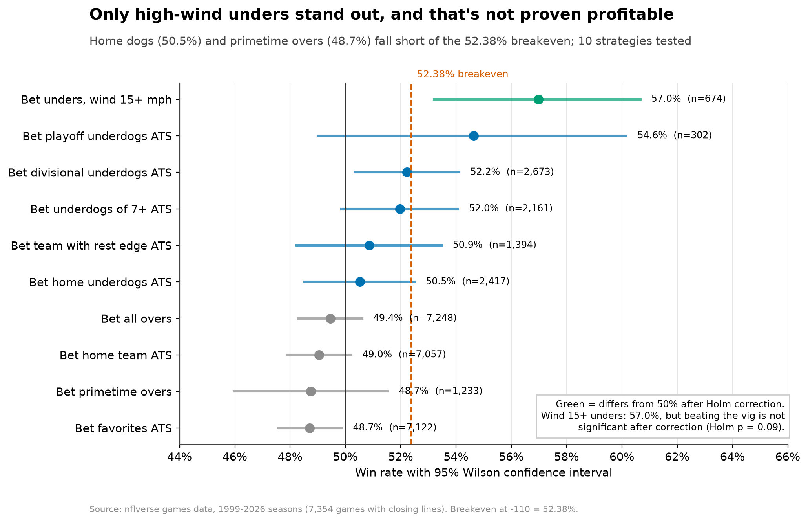
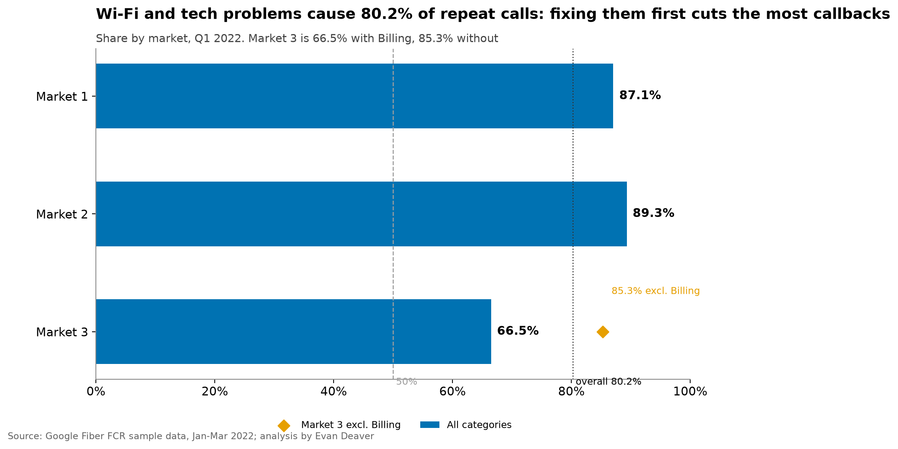
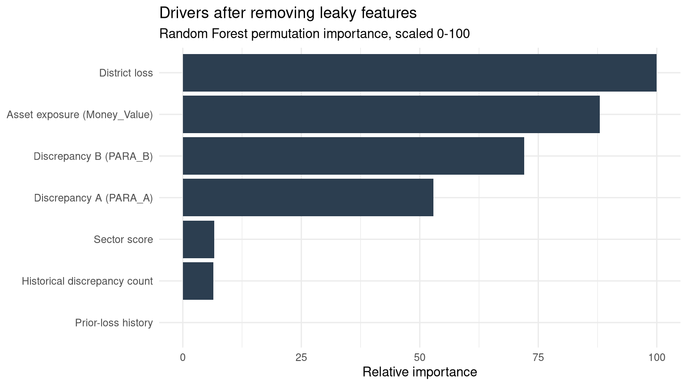

# Evan Deaver: Data Analyst Portfolio

## Overview
I'm Evan, a Google-certified data analyst (SQL, Python, R, Excel, Tableau) moving into **data analyst and data engineer roles (Remote, US)**. I build tested SQL pipelines, publish dashboards, check models for flaws such as target leakage, and do data QA on AI model outputs.

**What's here:** six self-contained projects in [`projects/`](projects), each opening with an overview (what, why, key result, chart), a "what's in this folder" table and how to run it. Start with the table below; [Steam Pulse](projects/steam-pulse#run-the-dashboard) includes an interactive Streamlit dashboard you can run locally in a few commands.

📄 **Resume:** [PDF](https://github.com/edeaver06/Data_Analytics_Portfolio/raw/main/resume/evan-deaver-resume-public.pdf)

## Portfolio Projects
| | Project | Result |
|---|---|---|
|  | [**Olist: When the Parcel Is Late, the Stars Fall**](#olist-ecommerce) | Reviewed after delivery, late orders score 3.78★ vs 4.29★ on time. The least reliable seller quartile is late 9.6% vs 6.9% for the best. |
|  | [**Can You Beat the NFL Closing Line?**](#nfl-closing-line) | No popular angle beats the 52.38% breakeven at -110 in a statistically defensible way. Closing spreads are unbiased (slope 1.04). |
|  | [**Markets vs Polls: Who Called It Better?**](#markets-vs-polls) | 1 day out: Brier 0.042 (Polymarket) and 0.043 (Kalshi) vs 0.053 (polls). This is one election, so it isn't evidence that markets beat polls in general. |
|  | [**Google Fiber: Repeat Calls & First-Contact Resolution**](#google-fiber-fcr) | Wi-Fi & Internet + Technical Troubleshooting drive 80.2% of repeat calls. |
|  | [**Steam Pulse** *(in progress)*](#steam-pulse) | Across 1,029 tracked Steam games there were 6.22M concurrent players, and 10 games held 40.1% of them. |
|  | [**Audit Risk Model: A Target-Leakage Case Study**](#operational-risk-briefing) | My model's 97.8% accuracy was invalid (the label was built from its top feature). Rebuilt on 7 raw inputs vs a 60.6% baseline, the conclusions reverse. |

## Table of Contents
- [Overview](#overview)
- [Portfolio Projects](#portfolio-projects)
- [Earlier Work](#earlier-work)
- [Skills](#skills)
- [Experience](#experience)
- [Education](#education)
- [Certificates](#certificates)
- [Contact](#contact)

### Olist: When the Parcel Is Late, the Stars Fall
**Code:** [`projects/olist-ecommerce`](projects/olist-ecommerce)

**Goal:** Measure how late deliveries affect review scores, and find which sellers and routes cause them.

**Description:** 99,441 orders from a Brazilian e-commerce marketplace, modeled in layered DuckDB SQL marts.

**Skills:** data modeling, window functions, cohort analysis, hypothesis testing, automated testing (70 tests).

**Technology:** SQL (DuckDB), Python, pandas, pytest.

**Results:** Reviewed after delivery, late orders score 3.78★ vs 4.29★ on time. The least reliable seller quartile is late 9.6% vs 6.9% for the best.

### Can You Beat the NFL Closing Line?
**Code:** [`projects/nfl-closing-line`](projects/nfl-closing-line)

**Goal:** Test whether the NFL betting market is efficient and whether popular betting angles beat the -110 vig.

**Description:** 7,354 games from 1999 through early 2026, using nflverse schedule and line data.

**Skills:** regression, calibration, binomial tests, multiple-testing correction, walk-forward validation.

**Technology:** SQL (DuckDB), Python, statsmodels, pytest.

**Results:** No popular angle beats the 52.38% breakeven at -110 in a statistically defensible way. Closing spreads are unbiased (slope 1.04).

### Markets vs Polls: Who Called It Better?
**Code:** [`projects/markets-vs-polls`](projects/markets-vs-polls)

**Goal:** Score how accurately prediction markets and poll averages forecast the 2024 US presidential race, state by state.

**Description:** Polymarket and Kalshi public APIs, an archived 538 polls CSV, and MIT Election Lab results.

**Skills:** API ingestion, joining time series across sources, Brier scoring, bootstrap confidence intervals.

**Technology:** Python, SQL (DuckDB), pytest.

**Results:** 1 day out: Brier 0.042 (Polymarket) and 0.043 (Kalshi) vs 0.053 (polls). This is one election, so it isn't evidence that markets beat polls in general.

### Google Fiber: Repeat Calls & First-Contact Resolution
**Code:** [`projects/google-fiber-fcr`](projects/google-fiber-fcr)

**Goal:** Find which support categories and markets drive 7-day repeat calls.

**Description:** Google Data Analytics capstone scenario: 3 markets, 5 problem types, Q1 2022.

**Skills:** data cleaning, aggregation, SQL/Python parity testing, dashboarding.

**Technology:** Python, pandas, SQL (DuckDB), Plotly, pytest.

**Results:** Wi-Fi & Internet + Technical Troubleshooting drive 80.2% of repeat calls.

### Steam Pulse *(in progress)*
**Code:** [`projects/steam-pulse`](projects/steam-pulse)

**Goal:** Build a growing history of Steam games to answer one question: what keeps a game alive?

**Description:** A scheduled pipeline tracking concurrent players, prices, reviews, tags and Steam Deck status for about 1,000 of the most-owned Steam games. History started 2026-10-12.

**Skills:** API ingestion with retries and rate limits, warehouse modeling, dbt tests and snapshots, scheduling.

**Technology:** Python, DuckDB, dbt, Streamlit, Tableau.

**Results:** 6.22M concurrent players across 1,029 tracked games, with 10 games holding 40.1% of them (latest snapshot, 2026-10-12). In the 2012–2026 history backfill, players drop 44% after the first month and then level off.

### Audit Risk Model: A Target-Leakage Case Study
**Code:** [`projects/operational-risk-briefing`](projects/operational-risk-briefing)

**Goal:** Check whether my earlier Random Forest's reported accuracy on 775 audit records was trustworthy.

**Description:** Showed that the label `Risk` equals `Audit_Risk > 1` in 100% of rows, and that `Audit_Risk` is computed from the model's top feature. Rebuilt the model on the 7 raw inputs and corrected the business conclusions.

**Skills:** model validation, target-leakage detection, feature selection, baseline comparison.

**Technology:** R, randomForest, tidyverse, R Markdown.

**Results:** The original 97.8% out-of-bag accuracy was invalid. The rebuilt model scores 98.5% vs a 60.6% majority-class baseline, but only because the label is a deterministic scoring rule. The honest drivers reverse the original "ignore asset value" advice.

## Earlier Work
- **[The Synthetic Predator](https://rpubs.com/slammerjammer/1423363)** (R), **[Cyclistic bike-share](https://rpubs.com/slammerjammer/1371255)** (R, Google DA capstone)
- **[Tableau Public dashboards](https://public.tableau.com/app/profile/evan.deaver/vizzes)**

To run a project: `cd projects/<name> && pip install -r requirements.txt && pytest -q` (or `make test` from the root).

## Skills
- **Languages & querying:** SQL (DuckDB, Google BigQuery, PostgreSQL), Python (pandas), R (tidyverse, ggplot2, caret), dbt, Advanced Excel (pivot tables, Power Query, XLOOKUP)
- **BI & visualization:** Tableau (Tableau Public), dashboards, metric reporting
- **Data quality & AI operations:** data validation and reconciliation, anomaly detection, automated testing, human-in-the-loop (HITL) model evaluation, multimodal data annotation

## Experience
- **AI Data Annotator & Model Evaluator**, Outlier.ai (2025–present): QA on LLM outputs for factual accuracy, safety and instruction-following; defect classification with an error taxonomy; multimodal text and vision annotation.
- **E-Commerce & Digital Storefront Operations**, self-employed (2003–present): multi-channel sales, catalog, pricing and fulfillment; tracking inventory turnover across 200+ active listings in Excel.

## Education
- **Bachelor of General Studies** (emphases: Business, Sociology, Education), Black Hills State University (2015)

## Certificates
- **Google Professional Certificates:** [Data Analytics](https://www.coursera.org/account/accomplishments/specialization/3JJSOM5SNM00) (2025), Business Intelligence (2026), AI (2026)
- **Kaggle:** [Intro to Machine Learning](https://www.kaggle.com/learn/certification/evandeaver/intro-to-machine-learning) (2026), [Python](https://www.kaggle.com/learn/certification/evandeaver/python) (2026)

## Contact
- **Email:** edeaver06@gmail.com
- **LinkedIn:** [linkedin.com/in/evan-deaver-276152a5](https://www.linkedin.com/in/evan-deaver-276152a5/)
- **Tableau Public:** [evan.deaver](https://public.tableau.com/app/profile/evan.deaver/vizzes)
- **Kaggle:** [evandeaver](https://www.kaggle.com/evandeaver) · **RPubs:** [slammerjammer](https://rpubs.com/slammerjammer)
