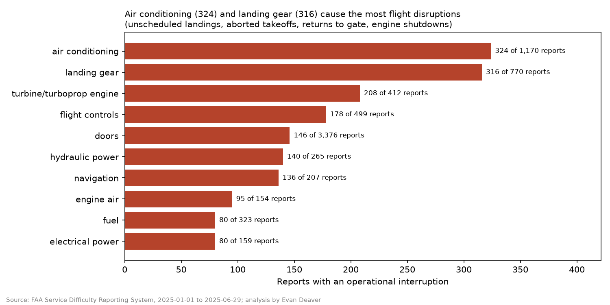
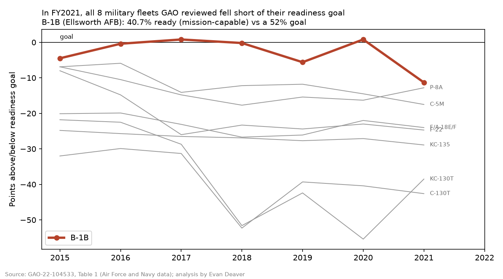

# Aircraft Readiness: What Grounds Airplanes, and How Fast Is It Reported?

### ▶️ [Try the live app](https://aircraft-ready-e.streamlit.app/)
No install needed; if the app has been idle it shows a short wake-up screen first.

**Which aircraft systems actually disrupt flights, and which defects keep coming back?** Across 34,350 FAA maintenance-difficulty reports on 6,521 aircraft (Jan–Jun 2025), 85% of reports were routine inspection findings. The 2,521 that disrupted a flight came mostly from three systems: air conditioning, landing gear and engines.

**[▶️ Live app](https://aircraft-ready-e.streamlit.app/) | [📖 Story](STORY.md) | [💻 Code](code/README.md)**

## The problem
Maintenance and readiness teams need the same answers every day: what takes aircraft out of service, which fixes don't hold, and whether reports arrive on time. Military aircraft-level status data isn't public, so this project uses the closest real public records and labels every metric as measured, estimated or simulated.

## Key findings
- **A few systems cause most disruptions:** air conditioning (324), landing gear (316) and engines (208) led the unscheduled landings, aborted takeoffs and returns to gate.
- **Some fixes don't hold:** 7.1% of in-flight problems came back on the same aircraft and system within 30 days. Air conditioning was worst at 15.7%.
- **About 2,100 flight hours per disruption.** Aircraft flew a median of 177 hours between reported difficulties.
- **Reporting speed depends on the operator:** the median delay was 3 days, but it ranged from same-day to 66 days by operator.
- **The readiness gap is real in the military too:** none of 8 Air Force and Navy fleets reviewed by GAO met its FY2021 mission-capable goal. The B-1B at Ellsworth AFB was at 40.7% against a 52% goal.

## What I built
- A star-schema data warehouse (fact and dimension tables) joining FAA difficulty reports to the FAA aircraft registry, with readiness KPIs and 22 automated data-quality checks.
- A seven-page Streamlit dashboard, including a clearly labelled simulated-fleet page for readiness, repair time and parts backlog.
- Model-ready exports and a documented data model for Power BI and Tableau.
- An honest data inventory showing which KPIs are real, which are estimated, and which public data can't support.

## Tools
SQL · DuckDB · Python (pandas) · Streamlit · Plotly · Power BI · matplotlib · pytest

## Go deeper
- [The story in plain English](STORY.md)
- [How it's built: data model, design decisions, how to run](code/README.md)
- [Data model and KPI definitions](code/docs/schema.md)
- Data: [FAA Service Difficulty Reports](https://sdrs.faa.gov) · [FAA Aircraft Registry](https://registry.faa.gov) · [GAO-22-104533](https://www.gao.gov/products/gao-22-104533) · [NASA C-MAPSS](https://data.nasa.gov)
