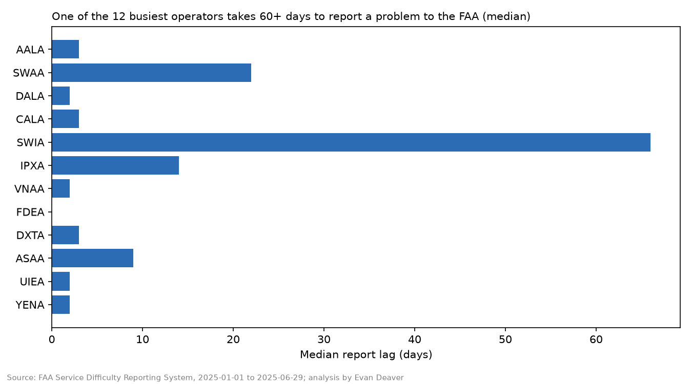
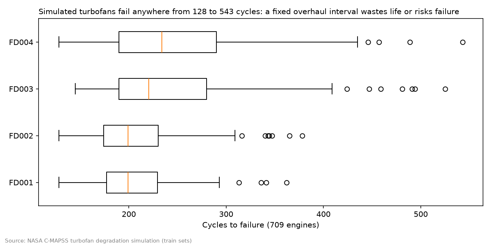

# Aircraft Readiness: the story in plain English

**▶️ [Try the live app](https://aircraft-ready-e.streamlit.app/)** · [Back to the project page](README.md) · [The code and how it's built](code/README.md)

**The setting:** an aircraft is "mission capable" when it can fly and do its job. When something breaks, it's down for maintenance, or down waiting on parts. Readiness analysts track how often that happens, why, and how long it lasts.

**The question:** using only real public data, which aircraft systems disrupt flights, which problems keep coming back, and how quickly are problems reported?

**The data:** US airlines and charter operators must report serious mechanical problems to the FAA. These are *Service Difficulty Reports*. I pulled every report dated 1 January to 29 June 2025: 34,350 reports on 6,521 aircraft from 164 operators. I joined them to the FAA aircraft registry (year built, model, engines) and the FAA's system code list, which puts each problem in a system such as landing gear or air conditioning. For military context I used a GAO report on readiness, and for engine life a NASA engine-wear simulation.

> **Three terms:**
> - *ATA chapter* = the standard aviation system code (21 = air conditioning, 32 = landing gear, 72 = engines).
> - *Disruption* = a report where the crew had to act: an unscheduled landing, aborted takeoff, return to gate, engine shutdown or declared emergency.
> - *Repeat* = the same aircraft reporting the same system again within 30 days.

## 1. Most reports don't disrupt anything
85% of reports were problems found during scheduled inspections, mostly corrosion and cracks in skin, seat tracks and floor beams. They matter for safety, but almost none (0.2% or less) disrupted a flight.

## 2. Three systems cause most disruptions
Of the 2,521 reports that disrupted a flight, air conditioning (324), landing gear (316) and engines (208) led. Engine reports disrupted flights half the time, and landing gear reports 41% of the time.

**What this means:** a readiness team gets the most from targeting these few systems, not the high-volume inspection findings.

## 3. Some fixes don't hold
7.1% of in-flight problems came back on the same aircraft and system within 30 days. Air conditioning was worst at 15.7%.

**What this means:** repeats point to troubleshooting that swaps parts without finding the root cause.

## 4. How often do problems happen?
Each report records the aircraft's total flight hours, so I measured the hours flown between reports on the same aircraft. The median was 177 hours, and there were about 2,100 flight hours per disruption. This is an estimate: only *reportable* problems are counted.

## 5. Reporting speed depends on the operator
The median delay from problem to FAA report was 3 days, but operator medians ranged from same-day to 66 days.

## 6. Military readiness context
GAO reviewed 8 Air Force and Navy fleets, and none met its FY2021 mission-capable goal. The B-1B, based at Ellsworth AFB, was at 40.7% against a 52% goal. I checked every figure against the GAO report.

## 7. Engines don't wear out on schedule
In NASA's simulation, 709 engines ran until they failed, and they lasted anywhere from 128 to 543 cycles. That spread is why condition-based maintenance beats fixed overhaul intervals.

## What public data can't show, and what I did about it
Aircraft-by-aircraft status, repair work orders and parts orders aren't public. Rather than invent "real-looking" numbers, I built a **separate, clearly labelled simulated fleet** of 20 aircraft. Its failure rate and system mix come from the FAA data, and every other setting is a listed assumption tuned to the GAO readiness range. It shows a 60% mission-capable rate, about 320 parts orders and the backlog over time. It is demo data for dashboard design, not a finding.

## Caveats
- FAA reports come mostly from airlines, and reporting habits differ by operator.
- Six months is too short to show seasonal patterns.
- The FAA doesn't publish what its "precautionary procedure" codes mean. I inferred them from the report text and flagged each label.
