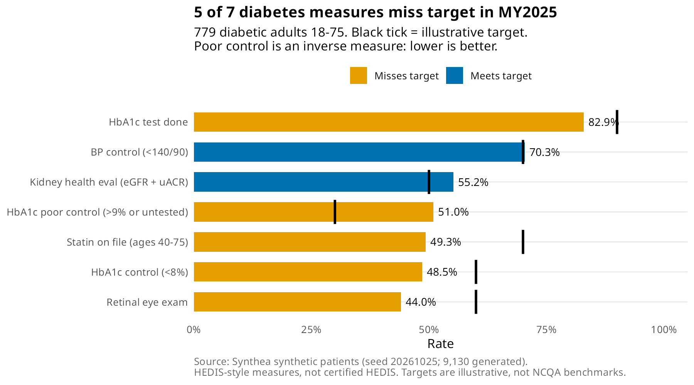

# Diabetes Care-Gap KPI Tracker (R, synthetic data)
Which diabetic patients are missing recommended care, and how is the clinic doing on the quality measures health plans pay for? This tracker follows 7 HEDIS-style diabetes measures against targets and builds a ranked outreach list for care coordinators.

In a synthetic population of 779 adults with diabetes, 5 of 7 HEDIS-style diabetes measures missed their target in measurement year 2025, and 672 patients still have at least one open care gap in 2026 so far.

> **Synthetic data only.** Every patient here was generated by [Synthea](https://synthetichealth.github.io/synthea/) (open source, Apache 2.0). No real people or PHI. The measures follow the *shape* of NCQA HEDIS diabetes measures (denominator, exclusions, numerator) but are **not certified HEDIS**: no licensed value sets, simplified exclusions. Targets are illustrative, not NCQA benchmarks.

## KPI results, MY2025 (diabetic adults 18-75)
| Measure | Numerator / Denominator | Rate | Illustrative target | Status |
|---|---|---|---|---|
| HbA1c test done | 646 / 779 | 82.9% | ≥ 90% | Misses |
| HbA1c control (<8%) | 378 / 779 | 48.5% | ≥ 60% | Misses |
| HbA1c poor control (>9% or untested), lower is better | 397 / 779 | 51.0% | ≤ 30% | Misses |
| BP control (<140/90) | 548 / 779 | 70.3% | ≥ 70% | Meets |
| Retinal eye exam | 343 / 779 | 44.0% | ≥ 60% | Misses |
| Kidney health evaluation (eGFR + uACR) | 430 / 779 | 55.2% | ≥ 50% | Meets |
| Statin on file (ages 40-75) | 365 / 740 | 49.3% | ≥ 70% | Misses |

Findings:
- Eye exams (44.0%) and HbA1c control (48.5%) are the furthest behind target.
- Rates were flat from 2017 to 2025. The one riser was statin use, up from 42.1% to 49.3%.
- Statin use is 75.2% at ages 65-75 but 38.6% at 45-64, the largest gap in any breakdown.
- Data problem: 264 of 779 patients had only HbA1c results below 4%, which is not clinically credible. Counting those as "controlled" would have reported 82.4% control instead of 48.5%. They count as tested but not controlled.

Recommendation: start outreach with the patients who have no valid HbA1c and uncontrolled blood pressure. The worklist ranks all 672 patients with open gaps by priority score; ties go to the patient with the longest time since their last visit (least likely to come in on their own before year end), then ID. Patient IDs shown are the first 8 characters of the synthetic Synthea ID.

## What I built
- R pipeline (`code/src`): raw Synthea CSVs → SQLite staging (names, addresses and SSNs dropped) → member-level measures → KPI marts by year, age band, sex and payer → prioritized worklist.
- SQL (`code/sql`): an independent SQL version of every measure, used to audit the R output (770 KPI rows, 0 mismatches), plus reporting views.
- Dashboard (`code/app/dashboard.html`, R flexdashboard): KPI tiles vs targets, trend lines, breakdown table, top-50 worklist. Screenshot: [images/05_dashboard_screenshot.png](images/05_dashboard_screenshot.png).
- Tests (`code/tests`, testthat): denominator and numerator edge cases (age 18/75/76, prediabetes excluded, deaths, A1c exactly 8.0/9.0, latest result wins, unpaired BP readings, eGFR without uACR, statin eligibility) plus data-quality checks.

Links: [Story](STORY.md) · [Code](code/README.md) · [Data sources](data-sources.md) · [Data problems hit](code/data-problems.md)

## Limits
Synthetic patients behave more uniformly than real ones, so trends are flatter than real-world data. Measures use only the measurement year (no prior-year eye-exam credit, no hospice or frailty exclusions). Payer groups under 60 patients (Uninsured, Dual Eligible) are too small to compare.
