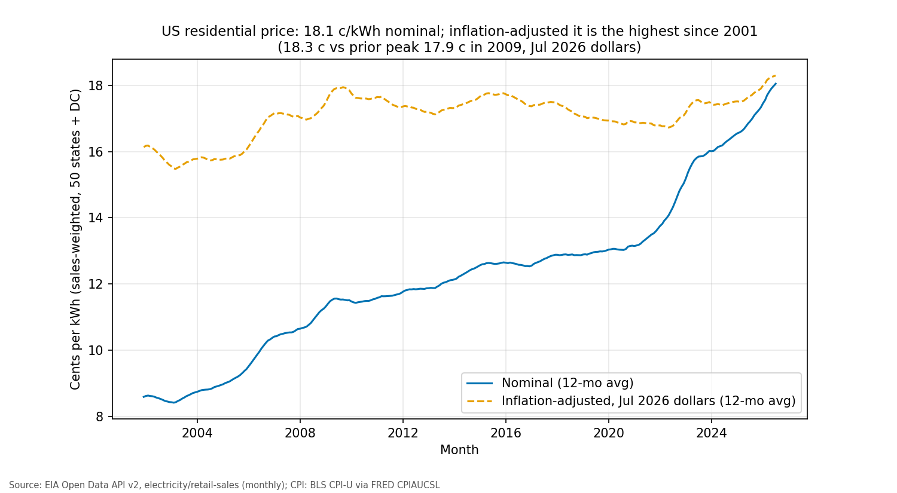

# US Electricity Prices by State, 2001-2026

Where have home power bills risen most? For households, energy analysts and policy staff: the US average rose from 8.58 to 18.02 cents per kWh since 2001 (+110%, about +13% after inflation), from 12.32¢ in North Dakota to 43.51¢ in Hawaii.

**How much have home electricity prices gone up, and where?** Across all 50 states and DC, the average US residential price rose from 8.58 to 18.02 c/kWh between 2001 and the latest 12 months (Aug 2025-Jul 2026): +110%, or about +13% after inflation. Hawaii is highest at 43.51 c/kWh and North Dakota lowest at 12.32.

**[📊 Google Sheets dashboard](https://docs.google.com/spreadsheets/d/1bRhtVTY08znmxWk9Amkb7G1pA-VjqgMjEWuWZTzX9so/edit) | [📖 Story](STORY.md) | [💻 Code](code/README.md)**

## Key findings
- Prices rose in every state since 2001, with big differences between states. The full ranked table of 51 is on the dashboard.
- 2021 to the latest 12 months: US residential +32% nominal, about +9% after inflation.
- States with more estimated data-center load have *lower* prices today, and there is no clear link to recent price increases. This is a cross-state association, not a cause.

## What I built
- A Python pipeline that pulls 46,971 monthly rows from the EIA API v2 (51 states x 3 sectors x 307 months), cleans them, and loads them into SQLite with quality checks and 9 pytest tests.
- A Google Sheets dashboard: a state dropdown drives XLOOKUP KPIs (latest price, change since 2001 nominal and inflation-adjusted, rank), a line chart, a ranked table with conditional formatting, and a QUERY region summary.
- Every dashboard number was checked against the database (0 mismatches across 52 rows).

## Tools
Python (pandas, requests, scipy, statsmodels) · SQLite · Google Sheets (XLOOKUP, FILTER, SORT, QUERY) · matplotlib · pytest

## Data and credits
EIA API v2 retail-sales (public domain). EPRI *Powering Intelligence* is cited only; no EPRI data is included. Data-center locations © OpenStreetMap contributors via PNNL IM3 Atlas (ODbL 1.0).
