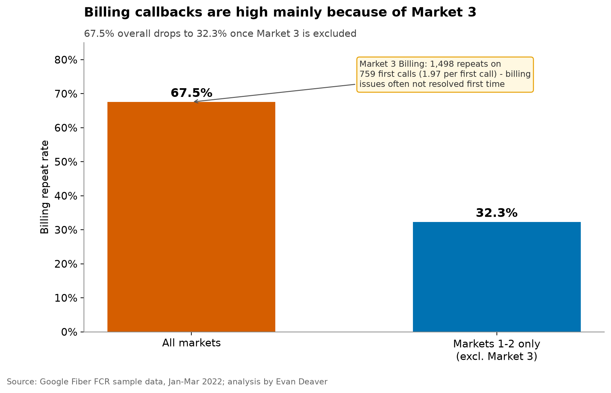
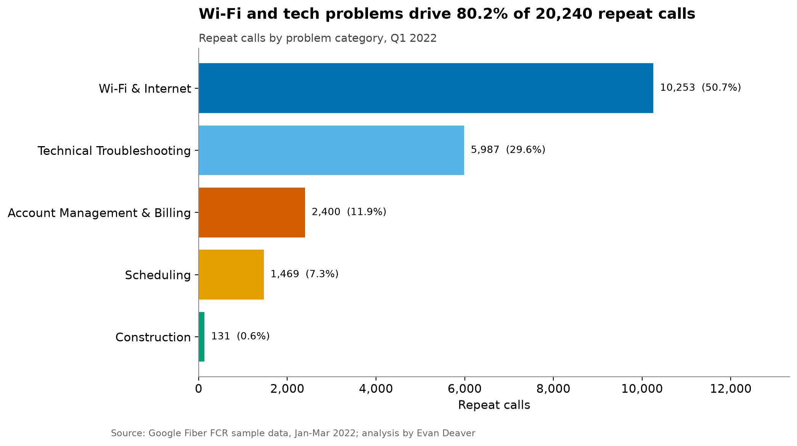
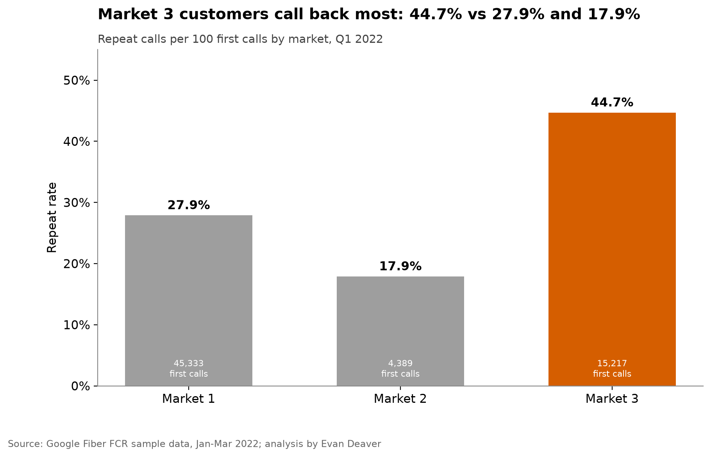
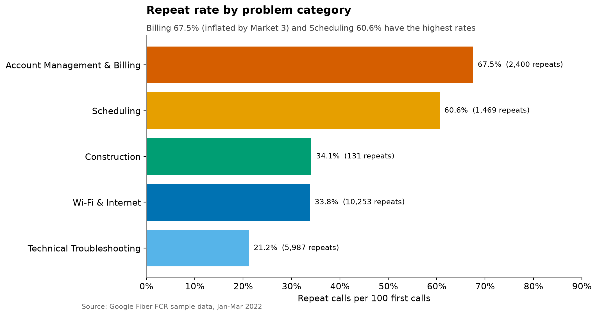
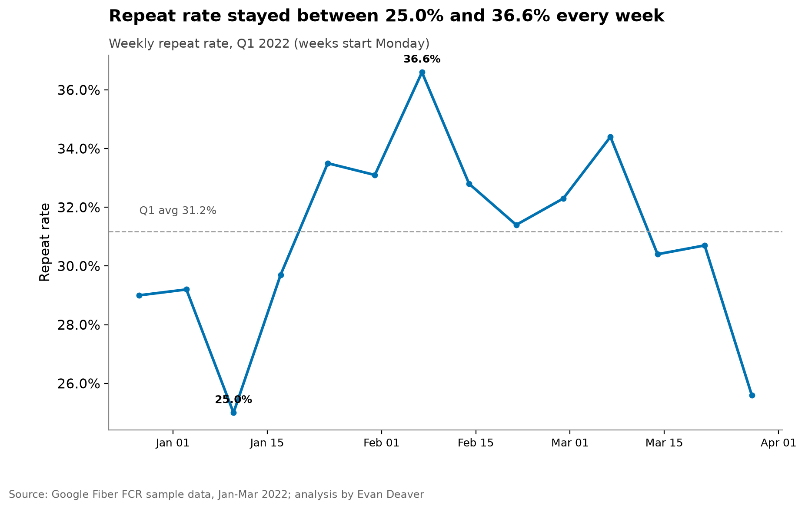
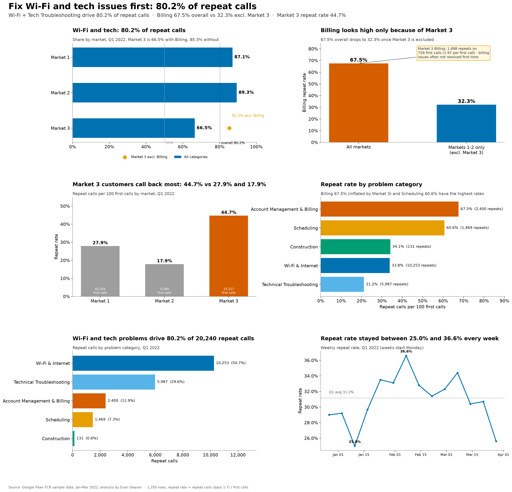

# Google Fiber Repeat Calls: code and engineering notes

Everything technical lives here. For the recruiter summary see the [project page](../README.md); for the plain-English walkthrough see [STORY.md](../STORY.md). Run every command below from this `code/` folder.

## How to run
```bash
python -m venv .venv && source .venv/bin/activate
pip install -r requirements-dev.txt   # pins + notebook tooling (requirements.txt alone runs src/ and tests)
python src/fcr.py                       # print summary tables
pytest -q                               # verify numbers + SQL/Python parity
jupyter nbconvert --to notebook --execute --inplace notebooks/google_fiber_fcr.ipynb   # rebuild draft figures
python src/polish_figures.py        # charts -> ../images/ and figures/, plus the dashboard (needs plotly)

# SQL: needs the separate DuckDB CLI (https://duckdb.org)...
duckdb < sql/fcr_metrics.sql
# ...or run it from Python with the duckdb package already in requirements.txt:
python -c "import duckdb; [print(duckdb.sql(q)) for q in open('sql/fcr_metrics.sql').read().split(';') if q.strip() and 'SELECT' in q]"
```

## Interactive dashboard
A Streamlit app in `app/` walks through the findings: a plain-English overview first, then interactive pages. It reads only the small extract in `app/data/`.
```bash
pip install -r app/requirements.txt
python app/make_extract.py   # refresh app/data after re-running the analysis
streamlit run app/streamlit_app.py
```
To deploy on Streamlit Community Cloud, set the main file to `projects/google-fiber-fcr/code/app/streamlit_app.py`.

## What's in this folder (`code/`)
| Folder | What it's for |
|---|---|
| `data/` | Raw case-study CSVs (`raw/market_1–3.csv`) |
| `sql/` | DuckDB SQL computing the same metrics as the Python (by category, market, week) |
| `src/` | Python: data loading and metrics (`fcr.py`), plus the chart and dashboard builder (`polish_figures.py`) |
| `notebooks/` | Step-by-step analysis notebook |
| `figures/` | Extra charts and the interactive Plotly dashboard (`dashboard.html`); README/STORY charts are in `../images/` |
| `tests/` | pytest checks that the key numbers hold and that SQL matches Python |

## Details
### Context
Case study from the **Google Data Analytics Professional Certificate** capstone (Google Fiber scenario). The data is fictional/anonymized: 1,350 rows covering 3 markets × 5 problem types × 90 days (Jan 1 – Mar 31, 2022).

### Headline
**Wi-Fi & Internet + Technical Troubleshooting drive about 80% of repeat calls (80.2% overall).** Their share of repeats varies by market: **market_1 87.1%, market_2 89.3%, market_3 66.5%**. Market_3 is lower mainly because of its very high Billing repeat volume; without Billing it would be 85.3%.


**Market_3 has the highest repeat rate, 44.7%** (6,806 / 15,217), against 27.9% in market_1 and 17.9% in market_2. It deserves a closer look, starting with its data.

**Billing, two ways:** 67.5% overall (2,400 / 3,553) but **32.3% without market_3** (902 / 2,794). Market_3 Billing logs 1,498 repeats against 759 first calls, about 1.97 repeats per first call. Repeats can outnumber first calls because one customer can call back several times, so this means billing issues in market_3 are often not resolved on first contact. That is worth investigating.



| Problem type | First calls | Repeat calls (≤7 days) | Repeat rate | Share of repeats |
|---|---:|---:|---:|---:|
| Account Management & Billing | 3,553 | 2,400 | 67.5% | 11.9% |
| Scheduling | 2,424 | 1,469 | 60.6% | 7.3% |
| Construction | 384 | 131 | 34.1% | 0.6% |
| Wi-Fi & Internet | 30,367 | 10,253 | 33.8% | 50.7% |
| Technical Troubleshooting | 28,211 | 5,987 | 21.2% | 29.6% |
| **Total** | **64,939** | **20,240** | **31.2%** | 100% |

By market: market_1 27.9% (12,647 / 45,333), market_2 17.9% (787 / 4,389), market_3 44.7% (6,806 / 15,217).






### Dashboard


Interactive version: [download dashboard.html](figures/dashboard.html) (Plotly, ~4.7 MB; open it locally in a browser, since GitHub shows HTML as source).

### SQL
Every headline metric is also computed in DuckDB SQL in [`sql/fcr_metrics.sql`](sql/fcr_metrics.sql), using CTEs and window functions: by category, by market, market × category, and week-over-week with `LAG`. A pytest checks that the SQL matches the Python.

### Suggestions (hypotheses to test, not proven by this data)
1. **Wi-Fi & Tech (biggest lever):** pilot better first-call diagnostics and measure the effect on callbacks.
2. **Market_3:** investigate why Billing issues there so often need more calls (about 1.97 repeats per first call), then review its other operations; it also has the highest Scheduling rate (75.9%).
3. **Billing:** hold conclusions until the market_3 data is explained. Outside market_3, Billing (32.3%) is in line with the other categories.
4. **Scheduling (60.6%, 1,469 repeats):** test giving customers appointment-status visibility.

Weekly repeats rise and fall with first-call volume. That is a correlation; it doesn't show the cause. The dataset has no call reasons, customer IDs, or costs.

Note: the first week (starting Mon 2021-12-27) is partial, since the data begins 2022-01-01, so its totals are low.

### Definitions & category mapping
- `contacts_n` = first calls that day; `contacts_n_1`…`contacts_n_7` = repeat calls 1–7 days later (nulls = 0).
- Repeat rate = Σ repeats / Σ first calls. FCR ≈ 100 − repeat rate. This is a simplification, because one customer can call back more than once.
- Codes → labels (per the case-study brief): type_1 Account Management & Billing · type_2 Technical Troubleshooting · type_3 Scheduling · type_4 Construction · type_5 Wi-Fi & Internet.

## Architecture
```
data/raw/market_1-3.csv ──► src/fcr.py (load, label codes, metrics) ──► notebooks/ + src/polish_figures.py ──► ../images/, figures/
                         └─► sql/fcr_metrics.sql (DuckDB: CTEs, window functions) ──► tests/ check SQL == Python
```

## Design decisions (and why)
1. **Repeat rate = repeat calls ÷ first calls.** A simple, explainable metric (FCR ≈ 100 − repeat rate); its limit (one customer can call back more than once) is stated.
2. **Every headline computed twice, in Python and in SQL.** A pytest checks they match, so a bug in one shows up as a mismatch.
3. **Show Billing with and without market_3.** Market_3 Billing logs more repeats than first calls (about 1.97 per first call), which can happen when customers call back several times. It is reported as a finding and shown both ways so the market_3 effect is clear.
4. **Suggestions are written as hypotheses to test.** The data has no call reasons, customer IDs or costs, so it can show where repeats cluster, not why.
5. **Colorblind-safe palette and one message per chart.** Charts are built for a non-technical reader.
6. **DuckDB for the SQL.** It runs the same SQL in-memory from Python with no database server.
