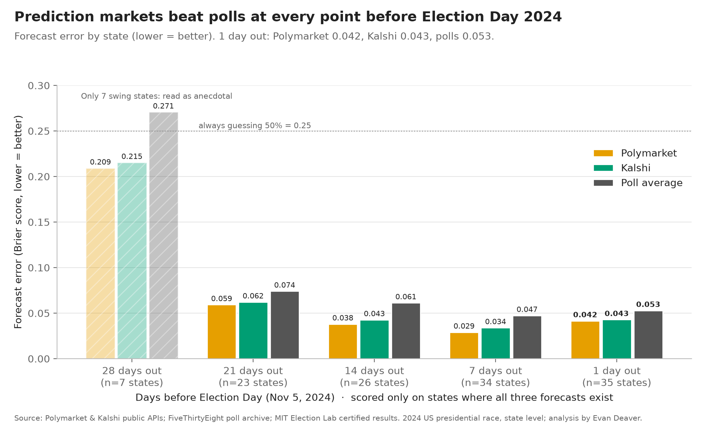

# Markets vs Polls: Who Called the 2024 Election Better?

### ▶️ [Try the live app](https://markets-polls-e.streamlit.app/)
No install needed; if the app has been idle it shows a short wake-up screen first.

**Did betting markets forecast the 2024 presidential race better than polls?** In 2024 both markets had lower (better) Brier scores than the poll average at every matched date. One day out the gap is small: statistically clear for Polymarket but not for Kalshi, and on log loss Kalshi was slightly worse than the polls. This is one election, and the polls all missed in the same direction, so it is not evidence that markets beat polls in general.

**[▶️ Live app](https://markets-polls-e.streamlit.app/) | [📖 Story](STORY.md) | [💻 Code](code/README.md)**

## The problem
Prediction markets such as Polymarket and Kalshi are often said to beat polls. Newsrooms, campaigns and investors who rely on forecasts need to know whether that's true, and why, before trusting either one. This project scores both on the same states and the same dates.

## Key findings
- **Markets scored slightly better 1 day out:** Brier score (lower is better) Polymarket 0.042, Kalshi 0.043, poll average 0.053, across 35 states. The gap is statistically clear for Polymarket but not for Kalshi.
- **The polls missed in one direction:** actual results were on average 3.2 points more Republican than the poll average, and the miss went the same way in 31 of 35 states.
- **Close calls decided it:** the poll average had the wrong leader in 4 states (MI, WI, PA, NV); the markets missed 2.
- **The two markets were nearly tied:** Polymarket edged out Kalshi at 7 and 14 days out (a small margin, about 10% lower error) and they tied at 1 day.

## What I built
- A data pipeline pulling daily prices from the Polymarket and Kalshi public APIs, archived 538 polls and certified MIT election results.
- DuckDB SQL that lines up every forecast on matched dates with no look-ahead (enforced by a test).
- Scoring code: Brier score, log loss, calibration and paired bootstrap intervals.
- A sensitivity check showing the poll result doesn't depend on its one tuning setting.

## Tools
Python (pandas, SciPy) · SQL · DuckDB · REST APIs · matplotlib · Jupyter · pytest

## Go deeper
- [The story in plain English](STORY.md)
- [How it's built: architecture, design decisions, how to run](code/README.md)
- [Walkthrough notebook](code/notebooks/markets_vs_polls.ipynb)
- [SQL](code/sql/forecasts.sql) · [Scoring code](code/src/forecast_scoring.py)
