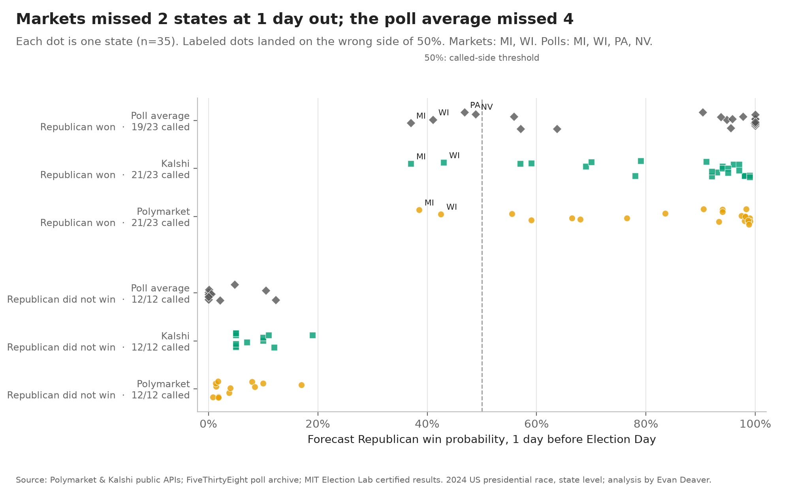
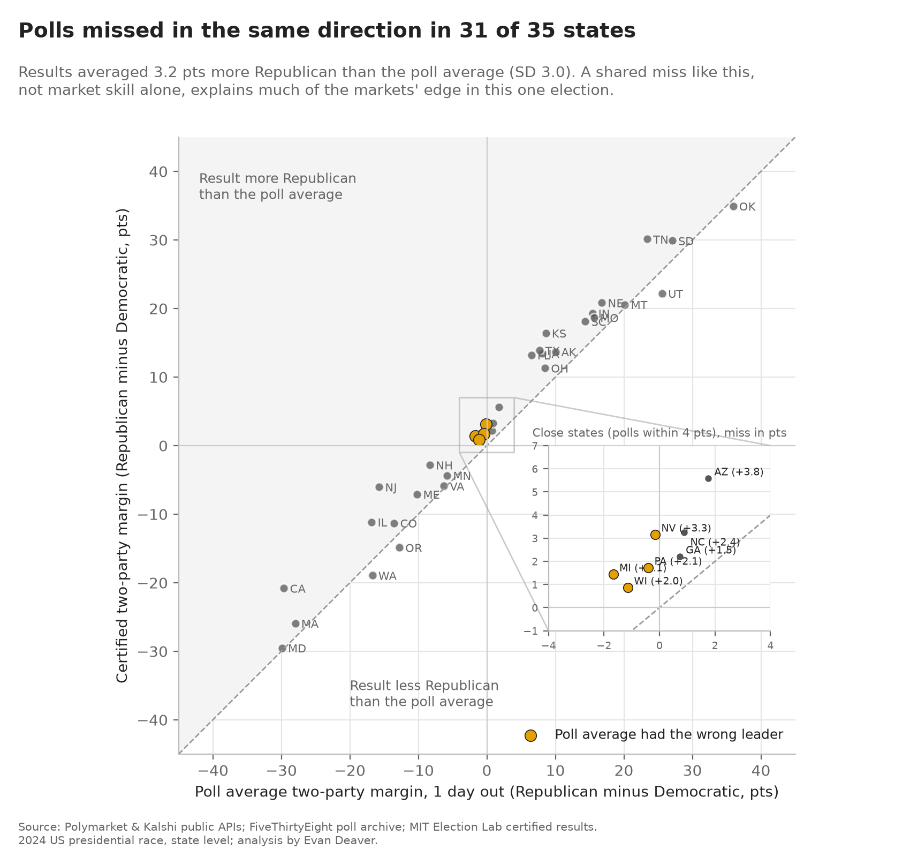

# Markets vs Polls: the story in plain English

**▶️ [Try the live app](https://markets-polls-e.streamlit.app/)** · [Back to the project page](README.md) · [The code and how it's built](code/README.md)

**The setting:** before an election, two kinds of forecasts compete. *Polls* ask voters who they'll vote for. *Prediction markets* (Polymarket and Kalshi) let people bet on the outcome; a price of 70¢ means the market thinks there's a 70% chance.

**The question:** in the 2024 US presidential election, which forecast did a better job state by state?

**The data:** daily market prices for each state (Polymarket for 47 states, Kalshi for all 51 from Oct 5, 2024), 18,095 rows of 2024 presidential poll data archived from FiveThirtyEight (about 2,000 distinct state polls), and the certified results from the MIT Election Lab.

> **One term:** the *Brier score* measures how good a probability forecast was. 0 is perfect; always saying 50/50 scores 0.25. Lower is better, and confident wrong calls are punished hardest.

> Every forecast is written as "chance the Republican wins the state". That's only a convention for the maths; this project scores accuracy, not which side is right.

## 1. Who was more accurate?

At every date from 21 days to 1 day before the election, both markets had lower (better) Brier scores than the poll average. One day out, across 35 states: Polymarket 0.042, Kalshi 0.043, polls 0.053.

**What this means:** In 2024 both markets had lower (better) Brier scores than the poll average at every matched date. One day out the gap is small: statistically clear for Polymarket but not for Kalshi, and on log loss Kalshi was slightly worse than the polls. The 28-day bar covers only 7 swing states, so it's anecdotal.

## 2. Where did each forecast get it wrong?

One day out, the poll average had the wrong leader in 4 states: Michigan, Wisconsin, Pennsylvania and Nevada. The markets also got Michigan and Wisconsin wrong, but leaned the right way in Pennsylvania and Nevada.

**What this means:** the difference came down to a few close states, not a broad gap in skill.

## 3. Why did the polls lose?

The polls missed in the same direction almost everywhere: the actual result was on average 3.2 points more Republican than the poll average, and the miss went that way in 31 of 35 states.

**What this means:** when every poll misses the same way, any forecast that leaned toward the eventual winner looks good. In an election where polls miss the other way, the ranking could flip.

## 4. Polymarket or Kalshi?

Very close. Polymarket was slightly better 7 and 14 days out (by a small margin, about 10% lower error), and they were tied 1 day out. Kalshi priced safe states at about 90–95% certainty, where Polymarket was at 96–99%, which cost it a little. That probably reflects its fees and order book rather than real doubt.

**What this means:** the two markets told almost the same story.

## Summary
1. Both markets had lower Brier scores than a simple poll average in 2024 (1 day out: 0.042 and 0.043 vs 0.053; 33 of 35 states right vs 31). The 1-day gap is statistically clear for Polymarket but not for Kalshi.
2. The gap came mostly from a one-directional polling miss (3.2 points toward Republicans).
3. The poll average got 4 close states wrong; the markets got 2 wrong.
4. Polymarket and Kalshi were nearly tied.

## Limitations (in plain words)
- **One election.** States move together, so 35 states is really much less evidence than it sounds. This doesn't prove markets beat polls in general.
- **A simple poll baseline**, not a full forecasting model like 538's.
- **Only states with polls.** Safe states without polling are left out, which focuses the test on close races.
- **Kalshi's state markets started Oct 5, 2024**, so earlier comparisons are limited.
- **4 states had no standard Polymarket market** (DE, DC, NM, NY), all uncompetitive.
