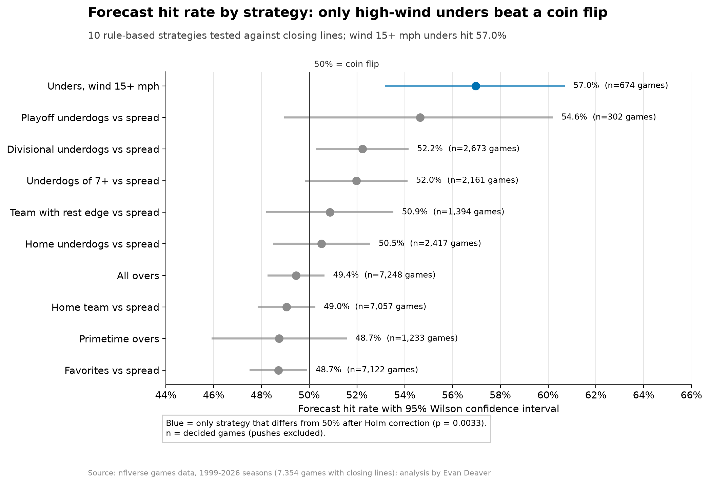

# Is the Market's Closing Price an Accurate Forecast? (NFL, 1999–2026)

Can anyone beat the betting market's final forecast of NFL games? For anyone judging how efficient a market's prices are: across 7,354 games (1999–2026), no common strategy beat it once the bookmaker's cut is counted (you need to win 52.38% of bets to break even).

### ▶️ [Try the live app](https://nfl-line-e.streamlit.app/)
No install needed; if the app has been idle it shows a short wake-up screen first.

**How accurate is the market's closing price as a forecast of NFL games?** Very accurate: across 7,354 games (1999–2026), closing spreads are unbiased, moneyline probabilities are well calibrated, and none of 10 common strategies beats the market's built-in margin in a statistically defensible way.¹

**[▶️ Live app](https://nfl-line-e.streamlit.app/) | [📖 Story](STORY.md) | [💻 Code](code/README.md)**

## The problem
A market price is a forecast. NFL closing lines (point spreads, totals and moneylines) price thousands of games a year, so they are a clean test of how efficient a forecasting market is. Popular strategies claim the market is systematically wrong (home underdogs, primetime overs, unders in wind). A strategy's forecasts would need to be right more than 52.38% of the time to beat the market's own forecast (the break-even rate at standard pricing). This project measures the market's forecast accuracy and tests whether any popular strategy clears that bar once it's tested properly.

## Key findings
- **The spread is right on average:** closing spreads are unbiased (slope 1.04, 95% CI 0.99–1.09), even though the typical game misses by 10.3 points. Totals are slightly off: games averaged 0.71 points **over** the closing total, so the total line ran slightly low (slope 0.93, 95% CI 0.87–1.00). That gap isn't large enough to clear the market's margin.
- **The famous biases aren't there:** home underdogs covered 50.5% and primetime overs hit 48.7%, both below the 52.38% breakeven.
- **Moneyline probabilities are well calibrated:** after removing the ~2.7% margin, the Brier score is 0.211 vs 0.250 for a coin flip (5,358 games).
- **Simple strategies fall short of the market:** favorites covered 48.7% of 7,122 decided games¹ (95% CI 47.6–49.9%), below the 52.38% needed.
- **One strategy stands out but isn't proven:** unders with 15+ mph wind were right 57.0% of the time (674 games), but the beat-the-margin test doesn't survive multiple-testing correction (Holm p = 0.09).

## What I built
- A DuckDB SQL model of 7,354 games, every strategy's picks and their hit rates.
- A Python statistics module: regression with robust errors, bookmaker-margin removal, calibration and Brier score, exact binomial tests with Holm correction.
- A walk-forward check: strategies chosen on seasons before 2015 and tested only on 2015+.
- Polished charts of forecast accuracy and strategy hit rates.

¹ All 7,354 games are used to test forecast accuracy. Strategy counts are smaller: for "favorites," 31 games were pick'ems with no favorite and 201 landed exactly on the spread (pushes), leaving 7,122 decided games.

## Tools
Python (pandas, statsmodels, SciPy) · SQL · DuckDB · matplotlib · Jupyter · pytest

## Go deeper
- [The story in plain English](STORY.md)
- [How it's built: architecture, design decisions, how to run](code/README.md)
- [Walkthrough notebook](code/notebooks/nfl_closing_line.ipynb)
- [SQL](code/sql/closing_line.sql) · [Stats code](code/src/clv.py) · [Data (nflverse)](https://github.com/nflverse/nfldata)
