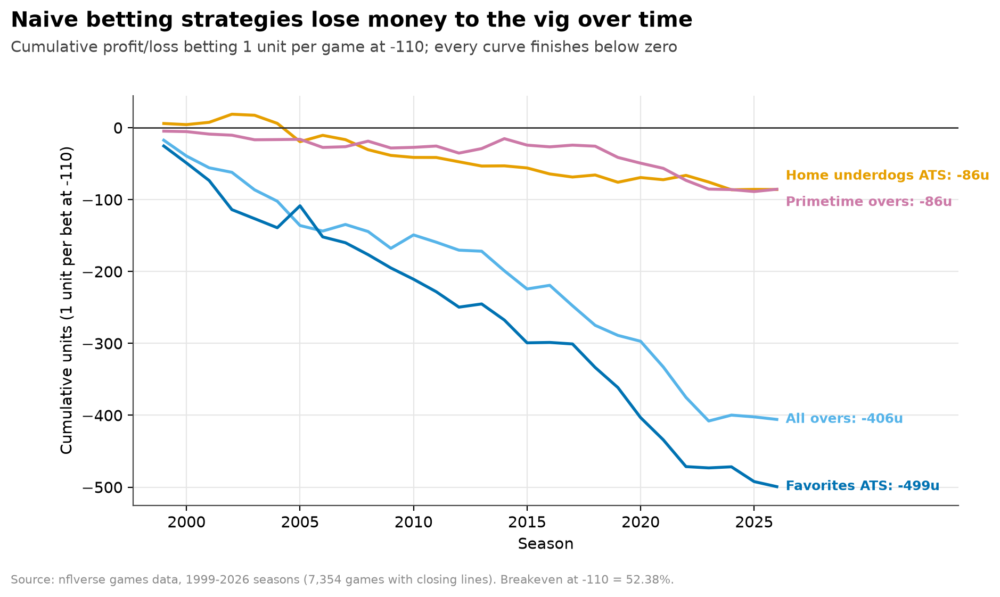

# Can You Beat the NFL Closing Line?

**Across 7,354 games (1999–2026), the closing line is a very good forecast, and no popular angle beats the -110 vig in a statistically defensible way.**


## Key results
- Closing spreads are unbiased (slope 1.04, 95% CI 0.99–1.09), but the typical miss is 10.3 points.
- Home underdogs cover 50.5% and primetime overs hit 48.7%, both below the 52.38% breakeven.
- Wind 15+ mph unders went 57.0%, but the beat-the-vig test doesn't survive Holm correction (p = 0.09).

## Explore
[Notebook](notebooks/nfl_closing_line.ipynb) · [SQL](sql/closing_line.sql) · [Stats code](src/clv.py) · [Data (nflverse)](https://github.com/nflverse/nfldata)

## How to run
```bash
python -m venv .venv && .venv/bin/pip install -r requirements.txt
curl -L -o data/raw/games.csv https://github.com/nflverse/nfldata/raw/master/data/games.csv
.venv/bin/python src/run_analysis.py        # prints results, writes data/clean/*.csv + images/*.png
.venv/bin/python -m pytest -q tests     # 6 tests
.venv/bin/python src/polish_figures.py  # polished charts
```
Notebook walkthrough: `notebooks/nfl_closing_line.ipynb`.

## Repo layout
```
data/       raw inputs + generated outputs
sql/        DuckDB SQL
src/        Python pipeline + chart scripts
notebooks/  walkthrough notebook
images/     charts used in this README
tests/      pytest checks
```

---
## Details
### Context
**Bottom line: the NFL closing line is a very good forecast, and none of the popular "angles" beat the -110 vig in a statistically defensible way.** 7,354 games, 1999 through early 2026 season (78 games of 2026 so far).

### Key findings
1. **Closing spreads are unbiased.** Regressing home margin on the closing spread gives slope 1.04 (95% CI 0.99–1.09) and intercept ≈ 0. The average miss is +0.08 points, but the typical miss (MAE) is 10.3 points: the line is right *on average*, not game-to-game.
2. **Totals show a small over bias that isn't bettable.** Games finished 0.71 points over the closing total on average, and the slope of 0.93 (95% CI 0.87–0.997) excludes 1, meaning high totals run slightly under and low totals slightly over. But overs hit only 49.4% once pushes are removed, so the bias doesn't turn into a bet.
3. **Moneylines are well calibrated.** After removing the ~2.7% bookmaker margin, implied win probabilities track actual results (Brier 0.211 vs 0.250 for a coin flip; 5,358 games with moneylines).
4. **The famous biases aren't there.** Home underdogs covered 50.5% (CI 48.5–52.5%) and primetime overs hit 48.7% (CI 46.0–51.5%), both below the **52.38%** you need at -110. Betting every home team, favorite, or over lost 5.6–7.0% per bet.
5. **One angle holds up after correction, but still isn't proven profitable:** unders in outdoor games with wind of 15+ mph went 384–290 (57.0%, CI 53.2–60.7%). It differs from 50% even after Holm correction across 10 tests (p = 0.003), but the test for *beating the vig* doesn't survive correction (Holm p = 0.09). Out of sample (2015+) it went 127–98 (56.4%, p = 0.12 vs breakeven, n = 225). Caveat: wind is measured at kickoff. A bettor at the close only has a forecast, and books now price wind in.

| Strategy (flat 1u at -110) | Bets | Win % | 95% CI | ROI | Holm p (≠50%) |
|---|---|---|---|---|---|
| Unders, wind 15+ mph | 674 | 57.0% | 53.2–60.7 | +8.8% | 0.003 |
| Playoff underdogs ATS | 302 | 54.6% | 49.0–60.2 | +4.3% | 0.66 |
| Divisional underdogs ATS | 2,673 | 52.2% | 50.3–54.1 | -0.3% | 0.20 |
| Underdogs of 7+ ATS | 2,161 | 52.0% | 49.9–54.1 | -0.8% | 0.50 |
| Team with 3+ day rest edge | 1,394 | 50.9% | 48.2–53.5 | -2.9% | 1.00 |
| Home underdogs ATS | 2,417 | 50.5% | 48.5–52.5 | -3.6% | 1.00 |
| All overs | 7,248 | 49.4% | 48.3–50.6 | -5.6% | 1.00 |
| Home team ATS | 7,057 | 49.0% | 47.9–50.2 | -6.4% | 0.66 |
| Primetime overs | 1,233 | 48.7% | 46.0–51.5 | -7.0% | 1.00 |
| Favorites ATS | 7,122 | 48.7% | 47.6–49.9 | -7.0% | 0.24 |

### Charts




### Responsible-gambling takeaway
At -110 you have to win 52.38% of bets just to break even. The market misses individual games by about 10 points, but it isn't wrong *on average*, and every simple, popular strategy here either loses or can't be told apart from luck. The one standout (wind unders) relies on information you don't have when you bet, and it's a well-known angle that books already adjust for. **Treat sports betting as paid entertainment with a negative expected value, not as income.** Set a budget you can afford to lose. If it stops being fun, get help: 1-800-GAMBLER (US) or a local equivalent.

### Methods
- **SQL (DuckDB, CTEs):** `sql/closing_line.sql` builds `games`, `strategy_bets`, `strategy_summary` (win rate and -110 ROI) and `spread_buckets`.
- **Python stats (`src/clv.py`):** OLS with robust (HC1) standard errors for efficiency; proportional vig removal for moneylines plus a calibration table and Brier score; exact binomial tests against 50% and against 52.38%; Wilson CIs; Holm correction across all 10 strategies; walk-forward check (strategies chosen on seasons before 2015, evaluated on 2015+).
- Pushes are excluded from win rates. ROI assumes flat 1 unit at -110 on every bet.

### Caveats
- These are **consensus closing lines**. Real prices vary by book and juice isn't always -110, and you can't usually bet the exact close. Opening lines and line movement (true closing-line value) aren't in this dataset.
- Primetime = Monday/Thursday or Sunday kickoff at 20:00+ (regular season). Wind and roof are only available for some games (wind recorded at kickoff).
- The strategy list is a pre-chosen menu of common angles, not an exhaustive search. Searching more angles would make false positives more likely.
- The 2026 season is partial (data pulled Oct 12, 2026).

### Data source
nflverse game and schedule data, from Lee Sharpe's `games.csv` (https://github.com/nflverse/nfldata/blob/master/data/games.csv). It's the same schedule and line data distributed through the nflverse data releases (https://github.com/nflverse/nflverse-data/releases) and `nflreadr::load_schedules()`. Columns used: `result`, `total`, `spread_line`, `total_line`, moneylines, `div_game`, `roof`, `wind`, rest days.
