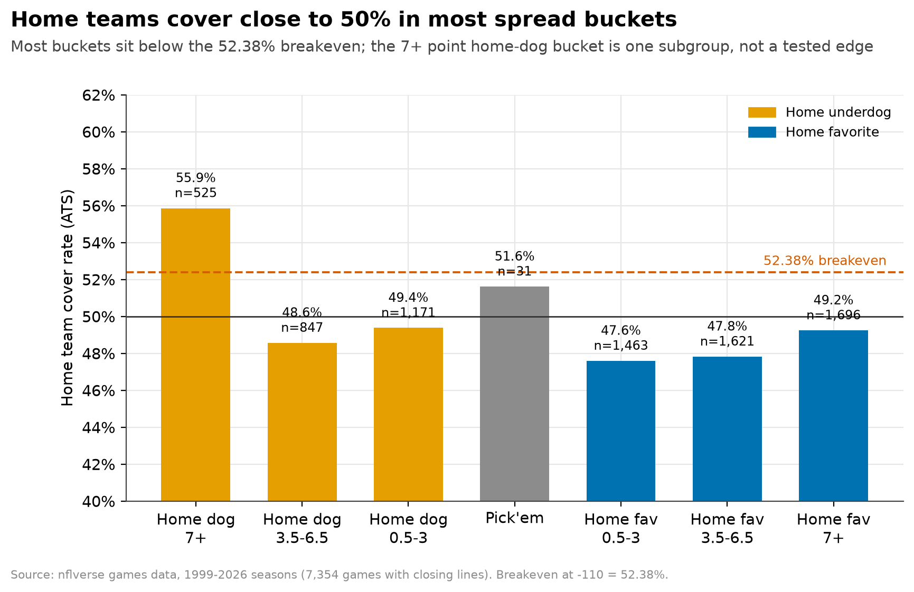
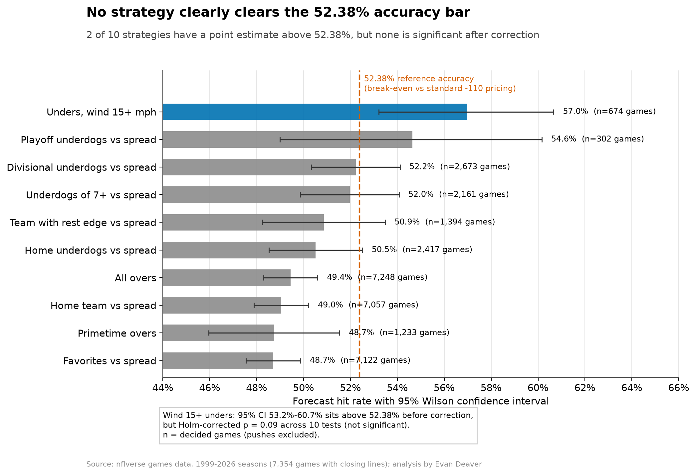
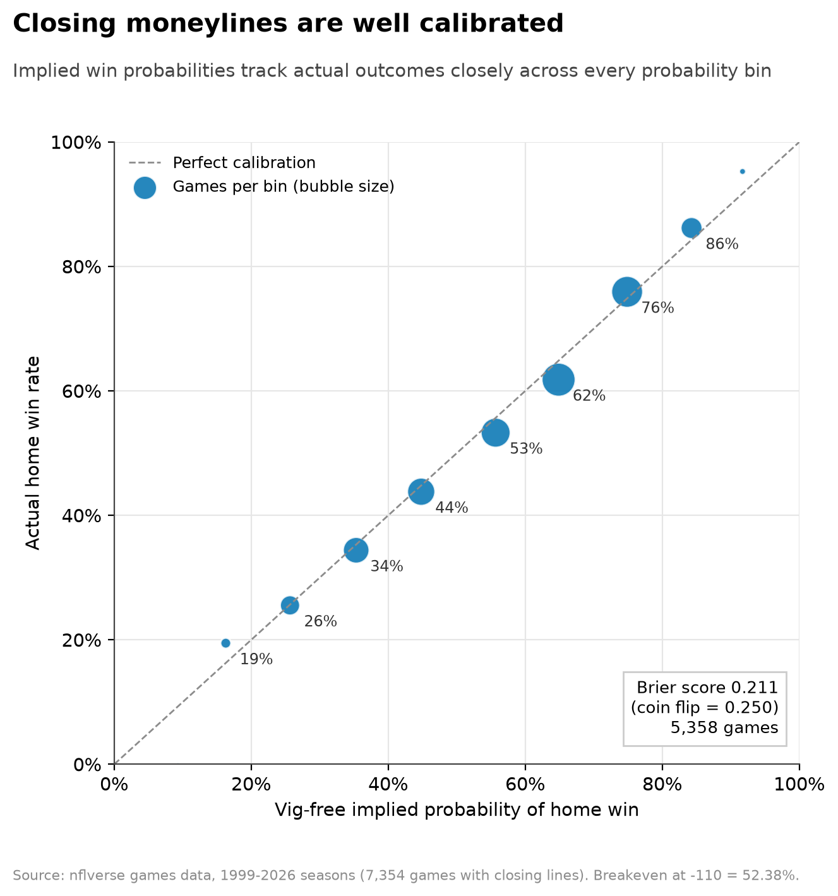
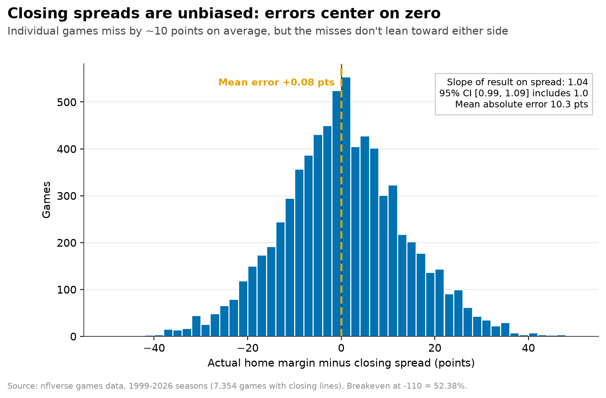

# Can You Beat the NFL Closing Line?: code and engineering notes

Everything technical lives here. For the recruiter summary see the [project page](../README.md); for the plain-English walkthrough see [STORY.md](../STORY.md). Run every command below from this `code/` folder.

## How to run
```bash
python -m venv .venv && .venv/bin/pip install -r requirements-dev.txt   # pins + notebook tooling (requirements.txt alone runs src/ and tests)
curl -L -o data/raw/games.csv https://github.com/nflverse/nfldata/raw/master/data/games.csv
.venv/bin/python src/run_analysis.py        # prints results, writes data/clean/*.csv + draft charts
.venv/bin/python -m pytest -q tests
.venv/bin/python src/polish_figures.py  # polished charts -> ../images/ and figures/
```
Notebook walkthrough: `notebooks/nfl_closing_line.ipynb`.

## Interactive dashboard
A Streamlit app in `app/` walks through the findings: a plain-English overview first, then interactive pages. It reads only the small extract in `app/data/`.
```bash
pip install -r app/requirements.txt
python app/make_extract.py   # refresh app/data after re-running the analysis
streamlit run app/streamlit_app.py
```
To deploy on Streamlit Community Cloud, set the main file to `projects/nfl-closing-line/code/app/streamlit_app.py`.

## What's in this folder (`code/`)
| Folder | What it's for |
|---|---|
| `data/` | `raw/games.csv` (nflverse) and `clean/` result tables |
| `sql/` | DuckDB SQL that builds games, strategy bets and summaries |
| `src/` | Python: stats (`clv.py`), the pipeline (`run_analysis.py`) and the chart builder (`polish_figures.py`) |
| `notebooks/` | Walkthrough notebook |
| `figures/` | Extra charts (README/STORY charts are in `../images/`) |
| `tests/` | pytest checks on the key statistics |

## Details
### Context
**Bottom line: the NFL closing line is a very good forecast, and none of the popular strategies beat the 52.38% bar set by the -110 price in a statistically defensible way.** 7,354 games, 1999 through early 2026 season (78 games of 2026 so far).

### Key findings
1. **Closing spreads are unbiased.** Regressing home margin on the closing spread gives slope 1.04 (95% CI 0.99–1.09) and intercept ≈ 0. The average miss is +0.08 points, but the typical miss (MAE) is 10.3 points: the line is right *on average*, not game-to-game.
2. **Totals show a small over bias that's too small to exploit.** Games finished 0.71 points over the closing total on average, and the slope of 0.93 (95% CI 0.87–0.997) excludes 1, meaning high totals run slightly under and low totals slightly over. But overs hit only 49.4% once pushes are removed, so the bias doesn't turn into a forecasting edge.
3. **Moneylines are well calibrated.** After removing the ~2.7% bookmaker margin, implied win probabilities track actual results (Brier 0.211 vs 0.250 for a coin flip; 5,358 games with moneylines).
4. **The famous biases aren't there.** Home underdogs covered 50.5% (CI 48.5–52.5%) and primetime overs hit 48.7% (CI 46.0–51.5%), both below the **52.38%** you need at -110. Picking every home team, favorite, or over was right 48.7–49.4% of the time.
5. **One strategy holds up after correction, but still isn't proven to beat the market:** unders in outdoor games with wind of 15+ mph went 384–290 (57.0%, CI 53.2–60.7%). It differs from 50% even after Holm correction across 10 tests (p = 0.003), but the test for *beating the 52.38% bar* doesn't survive correction (Holm p = 0.09). Out of sample (2015+) it went 127–98 (56.4%, p = 0.12 vs breakeven, n = 225). Caveat: wind is measured at kickoff. At the close only a wind forecast is known, and lines now price wind in.

| Strategy | Decided games | Hit rate | 95% CI | Holm p (≠50%) |
|---|---|---|---|---|
| Unders, wind 15+ mph | 674 | 57.0% | 53.2–60.7 | 0.003 |
| Playoff underdogs ATS | 302 | 54.6% | 49.0–60.2 | 0.66 |
| Divisional underdogs ATS | 2,673 | 52.2% | 50.3–54.1 | 0.20 |
| Underdogs of 7+ ATS | 2,161 | 52.0% | 49.9–54.1 | 0.50 |
| Team with 3+ day rest edge | 1,394 | 50.9% | 48.2–53.5 | 1.00 |
| Home underdogs ATS | 2,417 | 50.5% | 48.5–52.5 | 1.00 |
| All overs | 7,248 | 49.4% | 48.3–50.6 | 1.00 |
| Home team ATS | 7,057 | 49.0% | 47.9–50.2 | 0.66 |
| Primetime overs | 1,233 | 48.7% | 46.0–51.5 | 1.00 |
| Favorites ATS | 7,122 | 48.7% | 47.6–49.9 | 0.24 |

### Charts






### Takeaway
At the -110 price a strategy must be right 52.38% of the time to match the market. The market misses individual games by about 10 points, but it isn't wrong *on average*, and every simple, popular strategy here either falls short of that bar or can't be told apart from luck. The one standout (wind unders) relies on information that isn't known when the line closes.

### Methods
- **SQL (DuckDB, CTEs):** `sql/closing_line.sql` builds `games`, `strategy_bets`, `strategy_summary` (hit rate per strategy) and `spread_buckets`.
- **Python stats (`src/clv.py`):** OLS with robust (HC1) standard errors for efficiency; proportional vig removal for moneylines plus a calibration table and Brier score; exact binomial tests against 50% and against 52.38%; Wilson CIs; Holm correction across all 10 strategies; walk-forward check (strategies chosen on seasons before 2015, evaluated on 2015+).
- Pushes (results exactly on the line) are excluded from hit rates.

### Caveats
- These are **consensus closing lines**. Real prices vary by book and juice isn't always -110, and you can't usually bet the exact close. Opening lines and line movement (true closing-line value) aren't in this dataset.
- Primetime = Monday/Thursday or Sunday kickoff at 20:00+ (regular season). Wind and roof are only available for some games (wind recorded at kickoff).
- The strategy list is a pre-chosen menu of common angles, not an exhaustive search. Searching more angles would make false positives more likely.
- The 2026 season is partial (data pulled Oct 12, 2026).

### Data source
nflverse game and schedule data, from Lee Sharpe's `games.csv` (https://github.com/nflverse/nfldata/blob/master/data/games.csv). It's the same schedule and line data distributed through the nflverse data releases (https://github.com/nflverse/nflverse-data/releases) and `nflreadr::load_schedules()`. Columns used: `result`, `total`, `spread_line`, `total_line`, moneylines, `div_game`, `roof`, `wind`, rest days.

## Architecture
```
nflverse games.csv ──► sql/closing_line.sql (DuckDB: games, strategy_bets, summaries)
                   ──► src/clv.py (OLS with robust SEs, vig removal, Brier, binomial + Holm, walk-forward)
                   ──► src/run_analysis.py ──► data/clean/*.csv + findings.json ──► src/polish_figures.py ──► ../images/, figures/
```

## Design decisions (and why)
1. **Test against the real bar, 52.38%, not 50%.** At -110 a strategy must be right 52.38% of the time to match the market, so every strategy is tested against that.
2. **Holm correction across all 10 strategies.** Testing many angles makes some look good by luck; the correction controls for that.
3. **Walk-forward check.** Strategies chosen on seasons before 2015 are evaluated only on 2015+, so the test can't peek at the answer.
4. **Exact binomial tests and Wilson intervals.** Win/loss counts are small for some angles, where these are more reliable than normal approximations.
5. **Remove the bookmaker margin before judging moneylines.** Raw odds add up to more than 100%; proportional vig removal turns them into fair probabilities.
6. **Pushes excluded.** Keeps hit rates comparable across strategies.
7. **A pre-chosen menu of common angles, not a search.** Searching hundreds of angles would guarantee false positives.
