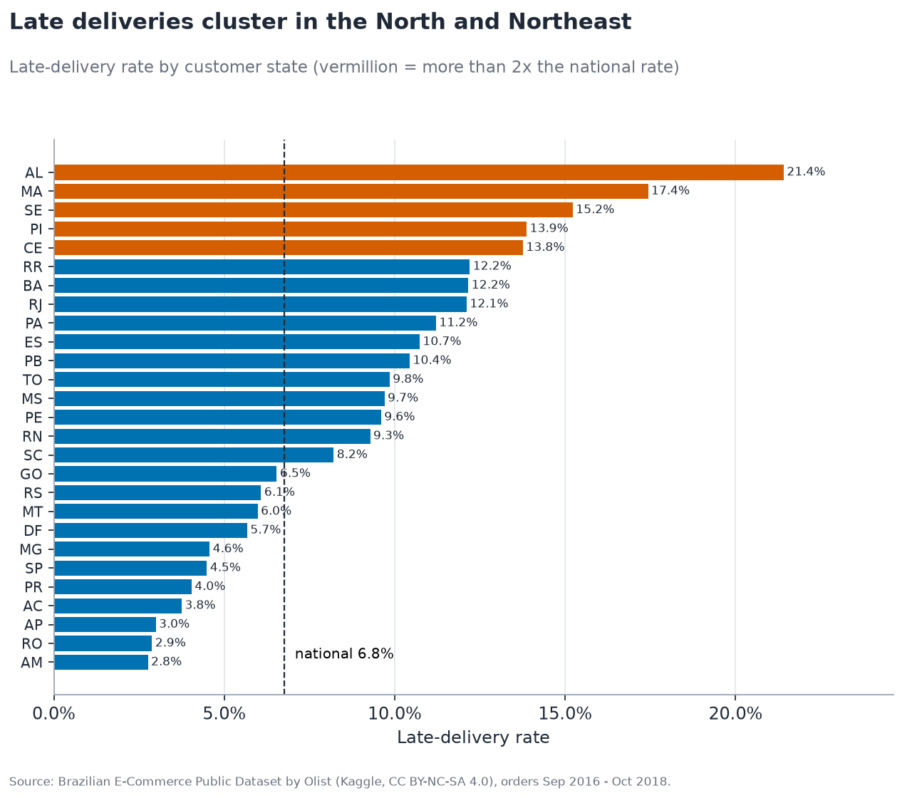
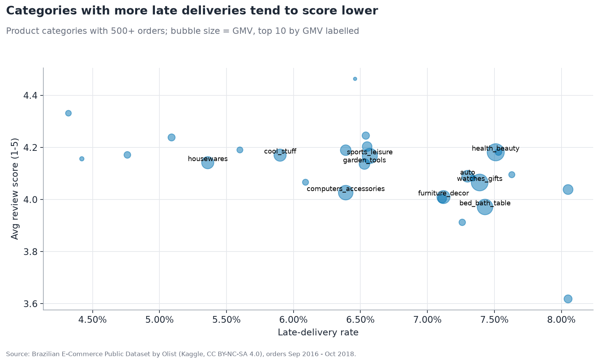

# Olist: When the Parcel Is Late, the Stars Fall

## Overview
**What:** A SQL analysis of 99,441 orders from Olist, a Brazilian e-commerce marketplace, looking at delivery delays, review scores, sellers and routes.

**Why:** Marketplace reputation lives on review scores, so the goal is to measure how much late deliveries hurt them and who or where causes the delays.

**Key result:** **Reviewed after delivery, a late order scores 3.78★ vs 4.29★ on time (−0.51★, 95% CI −0.60 to −0.43). But 84% of late-order reviews are written before the parcel arrives, and those average 1.97★.**


## Key results
- After-delivery reviews (primary): late orders get 1–2★ 18.3% of the time vs 9.3% on time. Stratified by state and item count the gap is −0.55★.
- Before-delivery reviews (secondary): 5,332 of 6,381 late-order reviews, 1.97★ on average, 71% of them 1–2★.
- Out of sample (ranked on 2017, measured on 2018), the least reliable seller quartile is late 9.6% vs 6.9% for the best, about 1.4x. That quartile is 89% São Paulo sellers. São Paulo → Alagoas is late 24.0% (n = 254, 95% CI 19.2–29.6%).
- GMV grew +138% (Jan–Aug 2018 vs 2017), but only 3.0% of customers ever order twice.

## Explore
[Notebook](notebooks/olist_story.ipynb) · [SQL marts](sql/) · [Tests](tests/) · [Data (Kaggle)](https://www.kaggle.com/datasets/olistbr/brazilian-ecommerce)

## How to run
```bash
python -m venv .venv && source .venv/bin/activate
pip install -r requirements.txt
python src/download_data.py   # pulls the 9 CSVs (~120 MB) and verifies row counts
python src/run_pipeline.py    # builds data/olist.duckdb, writes data/outputs/*.csv + headline_metrics.json
python src/make_figures.py    # writes images/
pytest -q
jupyter nbconvert --to notebook --execute --inplace notebooks/olist_story.ipynb  # optional walkthrough
```
The whole pipeline runs in about 5 seconds on a laptop. To explore the data yourself, run `duckdb data/olist.duckdb` and then `SELECT * FROM mart_lanes LIMIT 10;`.

## What's in this folder
| Folder | What it's for |
|---|---|
| `data/` | `outputs/` with the exported SQL marts and headline metrics (raw CSVs download via `src/download_data.py` and aren't committed) |
| `sql/` | Layered DuckDB SQL: load → staging → fact tables → 15 analysis marts |
| `src/` | Python: data download, pipeline runner, chart builder and notebook builder |
| `notebooks/` | Story notebook showing each mart next to its chart |
| `images/` | README charts (plus one interactive HTML chart) |
| `tests/` | 70 pytest checks: data integrity, pandas/SQL parity, and pinned README numbers |

---
## Details
### Context
SQL analysis of 99,441 orders from a Brazilian e-commerce marketplace (DuckDB · Python · pytest)

> **TL;DR:** Among customers who reviewed **after** their parcel arrived, a late order scores **3.78★ vs 4.29★** on time, a gap of **−0.51★ (95% CI −0.60 to −0.43)**. The much bigger story is that **84%** of late-order reviews were written **before** the parcel arrived, and those average **1.97★**: not having received the order yet goes hand in hand with 1★ reviews. Only **6.8%** of orders are late, even though Olist promises roughly twice the time it actually takes to deliver.


### The business question
Olist connects thousands of small Brazilian sellers to big marketplaces. Its reputation depends on review scores, and those scores are earned or lost in logistics. I wanted to answer one question:

**How strongly are late deliveries associated with worse reviews, and who or where are they concentrated?**

### Read this first: limitations
- **Observational data.** Lateness is *associated with* lower scores; this does not prove it causes them. The gap does survive simple controls (stratified by customer state and single vs multi-item order: −0.55★ after delivery, −2.03★ overall) and holds within every delivery-time band.
- **Review timing.** Olist sends the review survey around the *estimated* date, so 84% of late-order reviews (5,332 of 6,381) were created before delivery, versus 3% of on-time ones. Mixing those groups overstates the "product received late" effect, so the headline uses after-delivery reviews only.
- **Who reviews.** 646 delivered orders have no review, and customers choose whether to respond, so reviewers are a self-selected sample.
- **Multi-seller orders (1,278, 1.3%)** carry one order-level lateness flag, shared by every seller on that order.

### Headline findings
| # | Finding | Number |
|---|---|---|
| 1 | **Primary: reviewed after delivery, late orders score lower.** Late vs on time, both reviewed after arrival (n = 1,049 vs 86,635) | **3.78★ vs 4.29★**, gap **−0.51★** (Welch 95% CI −0.60 to −0.43; bootstrap −0.60 to −0.44). 1–2★ share 18.3% vs 9.3% |
| 2 | **Secondary: most late-order reviews come before the parcel arrives.** Share of late-order reviews written before delivery, and their score | **84%** (5,332 of 6,381) at **1.97★**, 71% of them 1–2★. Gap vs on time **−2.32★** (bootstrap CI −2.36 to −2.28) |
| 3 | All reviews pooled (what most Olist analyses report) | 2.27★ vs 4.29★, gap −2.02★ (95% CI −2.06 to −1.98); −2.03★ stratified by state and item count |
| 4 | **The gradient is steep.** 1–2★ share: on estimate day (still on time) → 1–3 → 4–7 → 8–14 days late | 12% → 32% → 68% → **80%** (all review timings) |
| 5 | **Promises are padded, yet still missed.** Average promised vs actual delivery time | **24.4 vs 12.5 days**, median 12 days early; 6.8% are still late |
| 6 | **Seller reliability only partly persists.** Sellers ranked on 2017 late rate (shrunk toward the mean), measured on 2018 orders, 46 sellers per quartile | Worst vs best quartile: **9.6% vs 6.9%** late in 2018 (about 1.4x), **3.98★ vs 4.13★**. The worst quartile is **89%** São Paulo sellers (vs 57% in the best) |
| 7 | **Geography matters.** Worst state: Alagoas (AL); worst lane: São Paulo seller → AL customer | **21.4%** late (3x national); **24.0%** on SP→AL (n = 254, Wilson 95% CI 19.2–29.6%) |
| 8 | **Sales are concentrated.** Sellers that generate 80% of GMV | **544 of 3,095** (18%) |
| 9 | **Growth is strong but retention is near zero.** GMV Jan–Aug 2018 vs Jan–Aug 2017; repeat-customer rate | **+138%**; only **3.0%** of customers ever order twice |
| 10 | **Credit card dominates, and installments unlock bigger baskets.** | 75% of orders; avg order R$101 paid in 1 installment vs **R$337** in 7+ |

Delivered GMV (orders with status `delivered` and a delivery date, the same base as the marts) is **R$13.22M**; all statuses including canceled and in transit is R$13.59M. Every number above comes from the SQL marts or `src/run_pipeline.py`, and `tests/test_headlines.py` pins each one, so this README can't silently drift from the code. (A Mann-Whitney test is still computed for reference, but at n ≈ 96k its p-value says nothing useful, so the README leads with mean differences and confidence intervals.)


### Recommendations (hypotheses to test)
1. **Fix delivery-lane performance before penalising individual sellers.** Ranked out of sample, last year's least reliable sellers are only about 1.4x as late this year (9.6% vs 6.9%), and that quartile is 89% São Paulo sellers. A lot of the "bad seller" signal is lane and carrier. Pilot carrier or SLA changes on SP→North-East lanes, and reserve seller penalties for sellers with 100+ orders who stay late after shrinkage.
2. **Re-estimate delivery dates by lane, not just by distance.** Estimates are already 12 days padded on average, yet SP→North-East lanes (AL, MA, SE, PI) still miss 15–24% of the time.
3. **Don't ask for a review before the parcel arrives.** 84% of late-order reviews are written before delivery and average 1.97★. Triggering the survey on actual delivery (plus a proactive apology or voucher once an order passes its estimate) could be A/B tested.
4. **Retention is the untapped lever.** With a 3% repeat rate, growth is almost entirely acquisition-driven. Customers with a bad first delivery are a natural target for a win-back test.

### More charts
| | |
|---|---|
|  |  |
|  |  |

**Where lateness happens:** late rate by seller-state → customer-state lane, for lanes with 100+ single-seller delivered orders. São Paulo sellers shipping to the North-East stand out.


**Why growth is all acquisition:** in each monthly cohort, under 1% of customers order again in any later month.


The category chart is also available as an interactive Plotly version: `images/05_category_matrix.html`.

### Notebook walkthrough
[`notebooks/olist_story.ipynb`](notebooks/olist_story.ipynb) tells the same story step by step, with each SQL mart shown next to its chart.

### How it's built
```
data/raw/*.csv ──► sql/00_load.sql          raw views (read_csv_auto)
               ──► sql/01_staging.sql       typed tables, English categories, deduped reviews, geo per zip
               ──► sql/02_fct_orders.sql    fct_orders (1 row/order) + fct_order_items (1 row/item)
               ──► sql/10-15_*.sql          17 analysis marts → data/outputs/*.csv
```
**SQL techniques on show:** layered CTEs; window functions (`ROW_NUMBER` for dedupe, `RANK`, and `NTILE` over a shrunk, out-of-sample ranking for seller tiers, `LAG` for month-over-month growth, running `SUM() OVER` for a Pareto curve and cumulative GMV, `FIRST_VALUE` for cohort retention); `QUALIFY`; `FILTER`; `MEDIAN`/`QUANTILE_CONT`; and `HAVING` thresholds.

### Grain traps handled (where most Olist analyses go wrong)
- **Items vs orders:** `order_items` has one row per item. It is aggregated to order level *before* joining payments and reviews, otherwise revenue double-counts. Tested: `SUM(gmv)` in `fct_orders` equals `SUM(price)` in `order_items`.
- **Duplicate reviews:** 547 orders have more than one review, and in 202 of them the scores conflict, so the rule matters: the latest-answered review is kept, using `ROW_NUMBER()`. Separately, 789 `review_id`s are shared across orders, so `review_id` is not a unique key.
- **Multi-seller orders (1.3%):** seller and category metrics are computed at item/seller grain, but lateness is an order-level flag shared by every seller on the order. Lane metrics use single-seller orders only.
- **Customers:** `customer_id` is per order, so retention uses `customer_unique_id`.
- **Geolocation:** the table has many rows per zip prefix, so coordinates are averaged to one row per prefix.

### Definitions
- **Late:** delivered date is after the estimated delivery date (compared at day level); delivered *on* the estimate day counts as on time. Only delivered orders with a delivery date are counted (96,470).
- **Reviewed before delivery:** review creation timestamp is earlier than the delivered timestamp.
- **Seller tiers:** rank on 2017 orders using a late rate shrunk toward the 2017 mean (Beta prior worth 50 orders), then measure on the same sellers' 2018 orders; 30+ delivered orders required in both years. Ranking and reporting on the same data would be circular.
- **GMV:** sum of item `price`, excluding freight. The headline figure covers delivered orders only.
- **Monthly trend:** covers Jan 2017 to Aug 2018. The sparse 2016 ramp-up months and the Sep–Oct 2018 cut-off are excluded.

### Tests (70, all passing)
- `test_integrity.py`: row counts match the published dataset, one row per order or item, reviews deduped, no GMV or payment fan-out, `is_late` consistent with the dates, no negative delivery times.
- `test_parity.py`: late rate, late vs on-time score gap, top-category GMV and repeat rate are recomputed independently in **pandas** and must match the SQL.
- `test_headlines.py`: pins every README number, checks that the after-delivery gap's t and bootstrap CIs exclude zero, and checks the SP→AL Wilson CI.
- `test_integrity.py` also checks that seller tiers are genuinely out of sample and that the review-timing split covers every reviewed delivery.

### License
The code is released under the [MIT License](../../LICENSE) (© 2026 Evan). The data is **not** covered by it; see below.

### Data & attribution
[Brazilian E-Commerce Public Dataset by Olist](https://www.kaggle.com/datasets/olistbr/brazilian-ecommerce) (Sep 2016 – Oct 2018), licensed **CC BY-NC-SA 4.0**. The CSVs are downloaded from Olist's own public mirror ([olist/work-at-olist-data](https://github.com/olist/work-at-olist-data/tree/master/datasets)). Their row counts are identical to the Kaggle release. Raw data is not committed to this repo. Seller and customer IDs are anonymised by Olist.

See [Read this first: limitations](#read-this-first-limitations) above.
