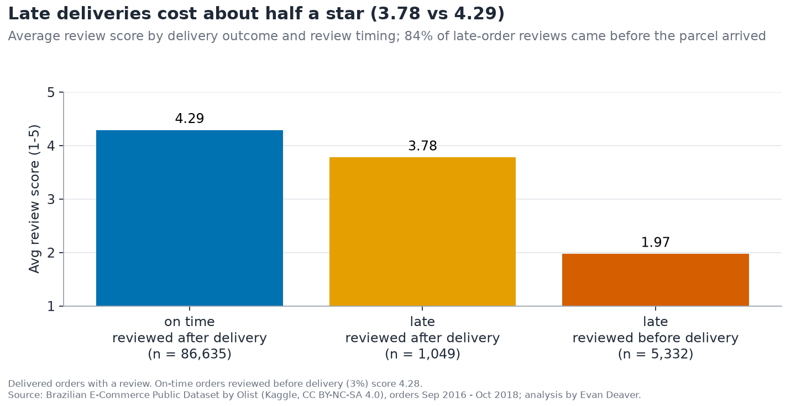

# Olist: When the Parcel Is Late, the Stars Fall

**How much do late deliveries hurt a marketplace's reviews?** Reviewed after delivery, a late order scores 3.78★ vs 4.29★ on time, and most late-order anger arrives before the parcel does.

**[📖 Story](STORY.md) | [💻 Code](code/README.md)**

## The problem
Olist connects thousands of small Brazilian sellers to big online marketplaces, and its reputation lives on review scores. The business needs to know how strongly late deliveries are linked to bad reviews, and whether the fix is sellers, routes or the review process itself.

## Key findings
- **Late orders score lower:** reviewed after delivery, 3.78★ vs 4.29★ on time (−0.51★, 95% CI −0.60 to −0.43).
- **Most late reviews come early:** 84% of late-order reviews are written before the parcel arrives, and those average 1.97★.
- **Routes matter more than "bad sellers":** last year's least reliable sellers are late only 9.6% vs 6.85% for the best (about 1.4x), and São Paulo → Alagoas is late 24.0% of the time.
- **Growth without loyalty:** sales grew 138% year over year, but only 3.0% of customers ever order twice.

## What I built
- A layered DuckDB SQL pipeline (load → staging → facts → 17 analysis marts) over 99,441 orders.
- Grain-safe joins and review deduplication, the traps most Olist analyses miss.
- An out-of-sample seller ranking and confidence intervals for every headline gap.
- 70 automated tests: data integrity, pandas/SQL parity and pinned headline numbers.
- Colorblind-safe charts and a story notebook.

## Tools
SQL · DuckDB · Python (pandas, SciPy) · matplotlib · Plotly · Jupyter · pytest

## Go deeper
- [The story in plain English](STORY.md)
- [How it's built: architecture, design decisions, how to run](code/README.md)
- [Story notebook](code/notebooks/olist_story.ipynb)
- [SQL marts](code/sql/) · [Tests](code/tests/) · [Data (Kaggle)](https://www.kaggle.com/datasets/olistbr/brazilian-ecommerce)
