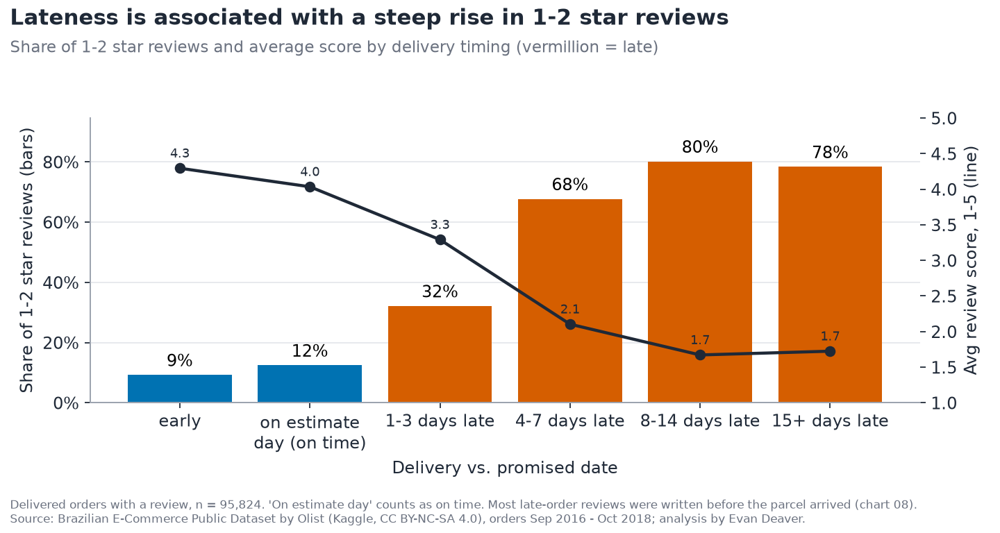
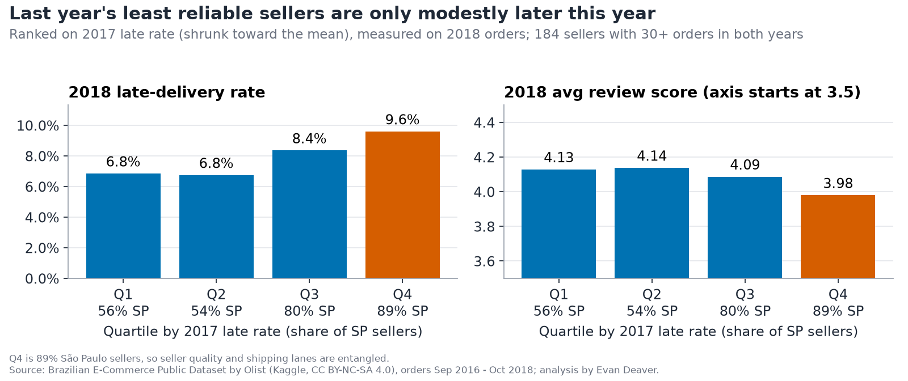
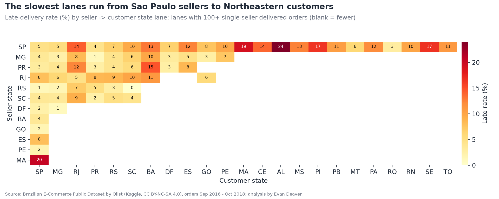
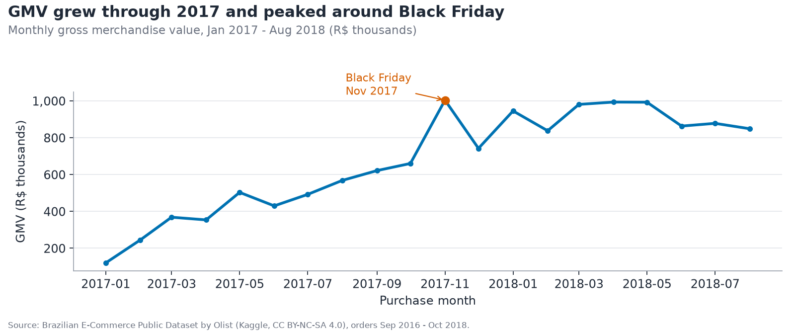
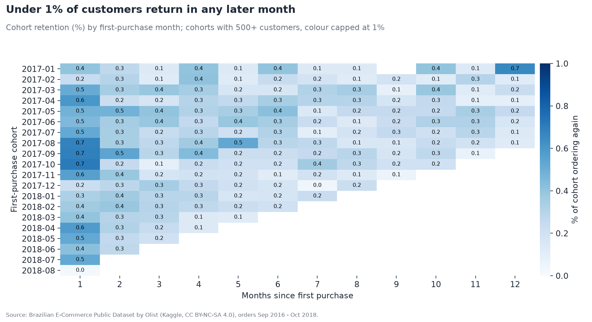

# Olist: the story in plain English

**▶️ [Try the live app](https://olist-e.streamlit.app/)** · [Back to the project page](README.md) · [The code and how it's built](code/README.md)

**The setting:** Olist is a Brazilian company that lets small shops sell on big online marketplaces. After each order, the customer is asked to rate it from 1 to 5 stars.

**The question:** how much do late deliveries hurt those star ratings, and where do the delays come from?

**The data:** 99,441 real (anonymized) orders from September 2016 to October 2018, published by Olist. 96,470 of them were delivered with a delivery date.

> **One term:** an order is *late* if it arrived after the delivery date the customer was promised.

## 1. How often are orders late?

Only 6.8% of delivered orders arrive late. That's partly because promises are generous: Olist promises 24.4 days on average, but parcels actually take 12.5.

**What this means:** lateness is fairly rare, but when it happens, reviews drop sharply. 8–14 days late, 80% of reviews are 1 or 2 stars.

## 2. How much does being late cost in stars?

This depends on *when* the customer wrote the review. Among customers who reviewed after their parcel arrived, a late order scored **3.78★ vs 4.29★** on time, about half a star lower. But 84% of late-order reviews (5,332 of 6,381) were written **before** the parcel arrived, and those averaged just **1.97★**.

**What this means:** the lowest scores come from reviews written while the customer was still waiting; sending the request after delivery is worth testing. Many analyses mix the two groups and report a much bigger gap (−2.02★); the honest "received late" effect is about −0.51★.

## 3. Are a few bad sellers to blame?

I ranked sellers by how often they were late in 2017, then checked the same sellers in 2018. The worst quarter was late 9.6% of the time vs 6.85% for the best, only about 1.4 times as often. And 89% of the worst group are in São Paulo.

**What this means:** last year's ranking only weakly predicts this year's lateness (9.6% vs 6.85%, about 1.4x), and most sellers in every group ship from São Paulo, so route and shipping matter alongside the seller; this data can't fully separate the two.

## 4. Where do deliveries go wrong?

Some routes are much worse than others. Parcels from São Paulo sellers to customers in Alagoas, in the North-East, were late 24.0% of the time (254 orders). Alagoas as a whole has the worst late rate of any state: 21.4%, about 3 times the national rate.

**What this means:** fixing a handful of long-distance routes (better carriers or more realistic delivery dates) is a promising thing to test before penalising individual sellers.

## 5. Is the business growing?

Yes. Sales from January to August 2018 were 138% higher than the same months in 2017.

**What this means:** demand is strong, but see the next question.

## 6. Do customers come back?

Rarely. Only 3.0% of customers ever placed a second order. In every monthly group with more than a handful of customers, under 1% ordered again in any later month.

**What this means:** growth comes almost entirely from new customers. Winning back people who had a bad first delivery is an untapped opportunity.

## Summary
1. Late orders reviewed after delivery score about half a star lower (3.78★ vs 4.29★).
2. Most late-order reviews are written before the parcel arrives, and they average 1.97★.
3. Routes, especially São Paulo to the North-East, matter alongside individual sellers; this data can't fully separate the two.
4. Sales are growing fast, but only 3.0% of customers return.

**Ideas to test:** send the review request after delivery, set delivery dates by route, and run a win-back offer for customers whose first order was late.

## Limitations (in plain words)
- **A link, not proof.** Late orders go with lower scores, but this data can't prove lateness causes them. The gap does hold after simple controls.
- **Customers choose whether to review**, so reviewers may not represent everyone.
- **Orders with several sellers (1.3%)** share one late/on-time flag.
- **The data ends in 2018** and covers one Brazilian marketplace.
