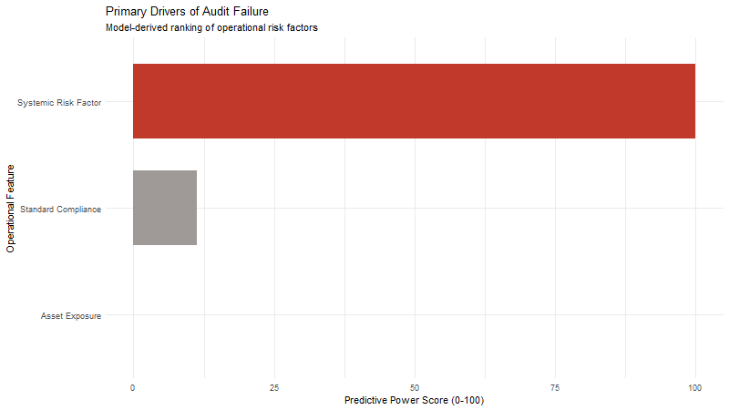

# Audit Risk Model: the story in plain English

[Back to the project page](README.md) · [The code and how it's built](code/README.md)

**The setting:** auditors check firms for financial risk, but they can't check everyone. A model that ranks firms by risk would help them decide where to look first.

**The question:** in April 2026 I built a model that seemed to predict audit risk with 97.8% accuracy. Was that real?

**The data:** 776 audit records of firms (775 after removing incomplete rows), with measurements such as discrepancy amounts, money involved, district losses and history, plus a "Risk" label.

> **One term:** *target leakage* = the model is given information that already contains the answer. It's like a student who scores 100% because the answer key was stapled to the exam.

## 1. What did the original model say?

The original model named a "Systemic Risk Factor" as by far the most important driver of risk, and said the money involved (asset exposure) didn't matter at all.

**What this means:** one feature explained almost everything, and the accuracy was almost perfect. Both are warning signs.

## 2. Where was the leak?

The "Risk" label wasn't an independent audit result. It was a rule: Risk = 1 exactly when `Audit_Risk` is above 1, true in 100% of 775 rows. And `Audit_Risk` is calculated by multiplying three scores, one of which is the same "Systemic Risk Factor" the model ranked first.

**What this means:** the model wasn't predicting risk; it was reading the answer key. Its 97.8% accuracy says nothing about real-world risk.

## 3. What happens when the leak is removed?

I removed every calculated score and kept only the 7 raw measurements an auditor actually records. The rebuilt model is still 98.5% accurate, against 60.6% for simply guessing "Pass" every time. That's because the label is a fixed scoring rule, and the model is learning that rule from the same inputs it uses.

**What this means:** the honest drivers are district loss, money value and one discrepancy amount (scores 100, 88 and 72). Money matters a lot, the opposite of the original advice.

## Summary
1. The original 97.8% accuracy came from target leakage.
2. The label is a formula, so this data can only show that a model reproduces the existing scoring policy.
3. Without the leak, money value is the #2 driver, so the advice "don't prioritise by asset value" is reversed.
4. The original risk tiers and 70% resource-allocation figures are withdrawn.

## Limitations (in plain words)
- **There's no real outcome to predict.** The label comes from a rule, not from confirmed fraud or later audit findings. A useful model would need that independent outcome.
- **The data's source and license still need to be confirmed and cited** before this is fully publishable.
- **A small dataset** (775 firms) from one setting.
