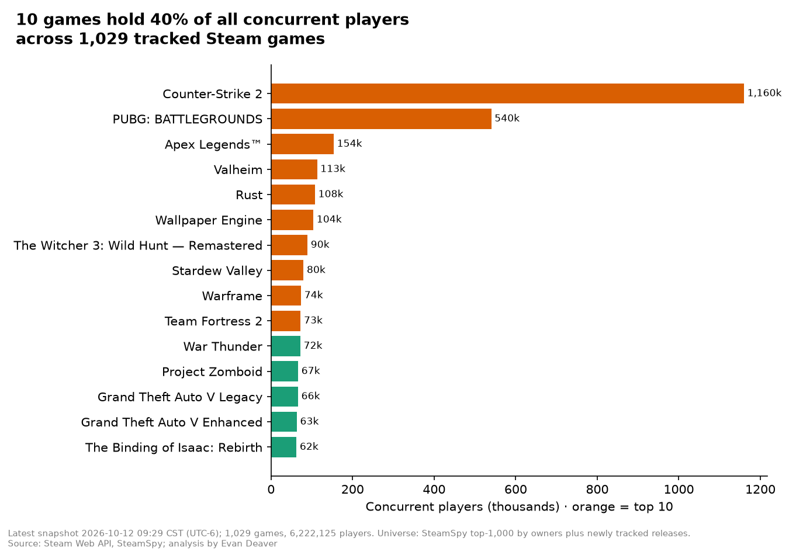

# Steam Pulse: What keeps a video game alive?

[Try the live app](https://steam-pulse-e.streamlit.app/)
Pick categories in the Game Finder and it returns the top game. Nothing to install. If the app has been idle, it shows a short wake-up screen first.

I wanted to know which Steam games people play and what keeps them playing. A few games hold most of the players: on Oct 12, 2026 the top 10 had 40.1% of 6.22M players. A game has about 44% fewer players one month after its launch month. Games with online co-op keep the biggest crowds.

[Live app](https://steam-pulse-e.streamlit.app/) | [Story](STORY.md) | [Code](code/README.md)

## The problem
Steam lists tens of thousands of games, but players' time is limited. A studio or publisher deciding what to build and when to discount needs to know where players spend their time, what the busiest games have in common, and how fast a launch fades.

## Key findings
- In a snapshot on Oct 12, 2026, 6.22M people were playing 1,029 tracked games, and the **top 10 held 40.1%**. The typical game had just 417 players.
- Games with online co-op have a typical crowd of about 1,090 players, almost 4× the 278 for games without it.
- A month after their launch month, games have about **44%** fewer players, then the numbers level off for years.
- In the first week of a sale, games had about **39% more** daily players than similar games not on sale (10,756 sales, 2019–20).

## What I built
- A Python pipeline, built to run on a schedule, that collects live player counts, prices, reviews and features for about 1,000 games from public Steam APIs. A 6-hourly snapshot job runs on a private machine; the public app uses a fixed snapshot.
- A DuckDB warehouse modelled with dbt (staging → marts, price history snapshots, 65 passing data checks).
- A 2012–2026 history backfill, used to measure launch decay and the effect of sales.
- A "best game" score that blends reviews, players and value for money, with a Python-to-SQL parity test.
- An interactive Streamlit dashboard with 7 pages, including the Game Finder.

## Tools
Python (pandas) · SQL · DuckDB · dbt · Streamlit · Plotly · matplotlib · pytest

## Go deeper
- [The story in plain English](STORY.md)
- [How it's built: architecture, design decisions, how to run](code/README.md)
- [History analysis details](code/analysis/README.md)
- [Story notebook](code/notebooks/steam_pulse_story.ipynb)
