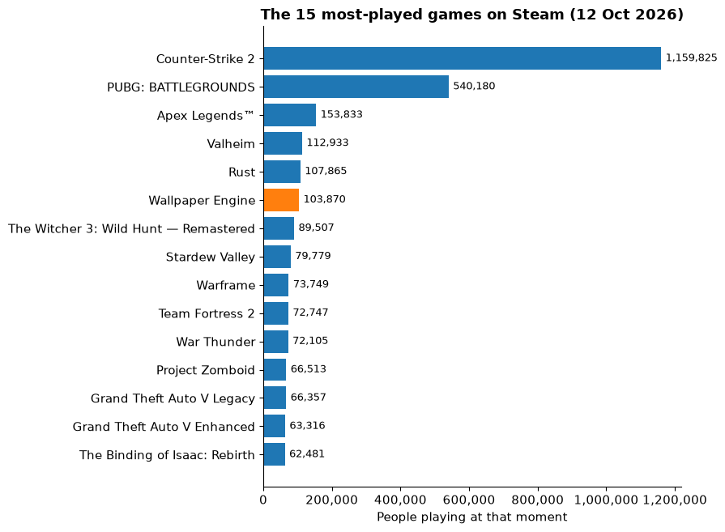
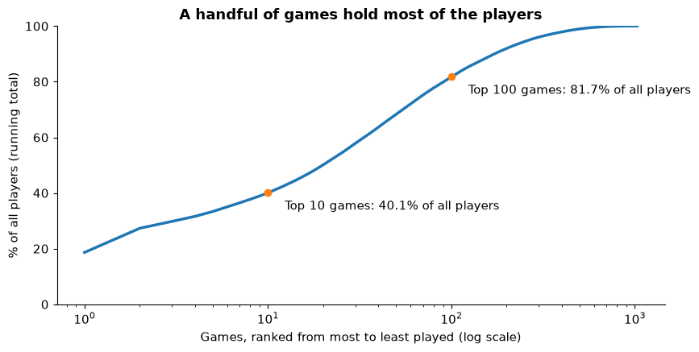
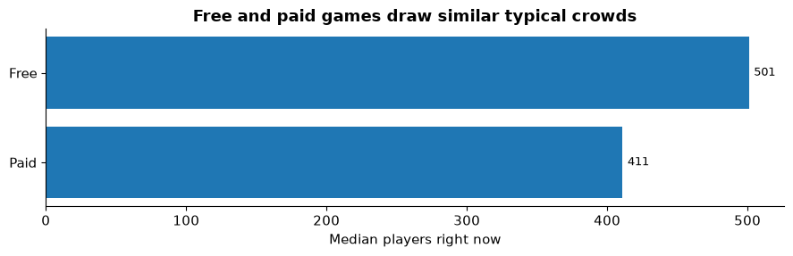
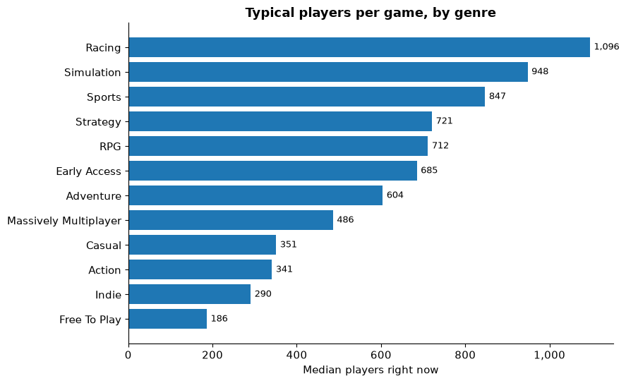
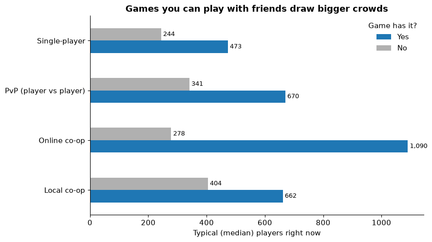
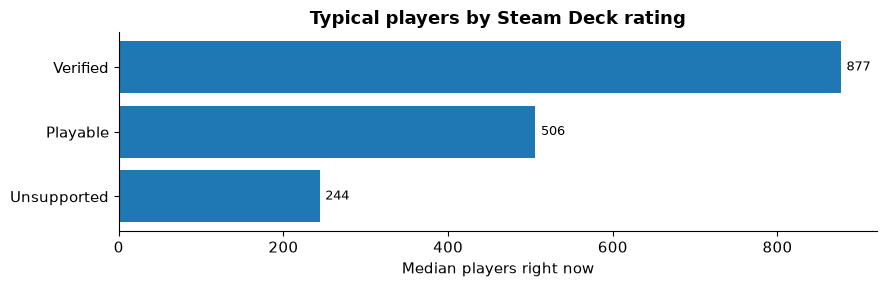
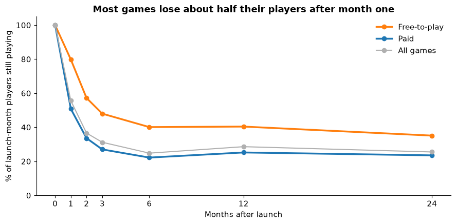
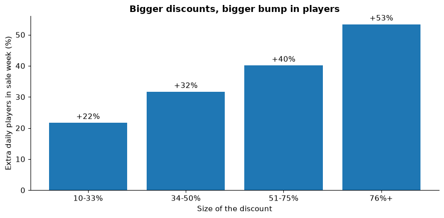
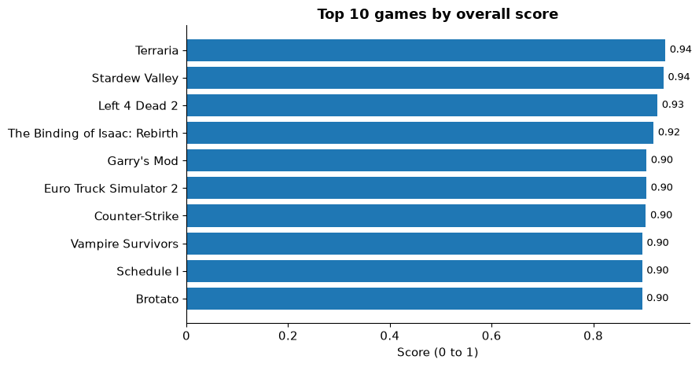

# Steam Pulse: the story in plain English

**▶️ [Try the live app](https://steam-pulse-e.streamlit.app/)** · [Back to the project page](README.md) · [The code and how it's built](code/README.md)

**Steam** is the biggest online store for PC games, a bit like an App Store for computer games. At any moment it shows how many people are playing each game *right now*.

**The question:** out of about 1,000 of the most popular games on Steam, which ones are people actually playing, and what do the busiest games have in common?

**The data:**
- A count of players for **1,029 games**, from a snapshot on Oct 12, 2026.
- Each game's store details: price, genre, features (like co-op), and reviews.
- Monthly player history going back to 2012 (from SteamCharts.com) and daily prices from 2019 to 2020 (a public research dataset).

**How to read this:** each section asks one question, shows one chart, and ends with a bold **What this means**.

> **One term you'll see a lot:** *median* = the middle value. Line all games up from smallest to biggest, and the median is the one in the middle. It's used instead of an average because a few giant games (like Counter-Strike 2) would make an average misleading.

## 1. Which games are people playing right now?

In a snapshot on Oct 12, 2026 (9:29 AM CST), about **6.22 million** people were playing one of these 1,029 games. The chart shows the 15 busiest.

Counter-Strike 2, a free team shooter, is in a league of its own with about 1.16 million players, more than the next three games combined. Note the orange bar: **Wallpaper Engine** isn't a game at all (it makes animated desktop backgrounds), but Steam lists it as one. Later rankings filter out apps like it.

**What this means:** a single game holds almost 1 in 5 of all players we tracked. Being in the top 15 means six-figure crowds; most games aren't close.

## 2. How spread out are the players?

Rank all 1,029 games from most to least played and keep a running total. The line shows what share of all players the top games account for.

The **top 10 games hold 40.1%** of all players, and the top 100 hold 81.7%. The typical game in this list (which is already the most-owned 1,000 on Steam) has only **417** people playing, and 657 of the 1,029 have fewer than 1,000.

**What this means:** attention on Steam is a "winner takes most" market. Even popular games usually have small, steady crowds, so a game studio should plan for a niche, not a hit.

## 3. Do free games attract more players than paid ones?

*Free-to-play* = free to download; the game earns money from optional in-game purchases. You might expect free games to win easily.

The typical free game has 501 players and the typical paid game has 411 (151 free vs 877 paid games). That gap is small enough to be chance. A statistical test in the analysis folder found no real difference. Paid games do get kinder reviews: about 89% positive vs 80% for free games.

**What this means:** "free" doesn't guarantee a crowd. Paid games keep up on players and make people happier.

## 4. Which genres draw the biggest typical crowds?

Most games list several genres (e.g. "Action, RPG"), so a game can count in more than one bar. Only genres with at least 20 games are shown, and non-game software is left out.

**Racing** (1,096), **Simulation** (948) and **Sports** (847) lead. **Action** (341), **Indie** (290) and **Free To Play** (186) are at the bottom, even though Action has the most games (685) and the biggest hits.

**What this means:** crowded genres like Action have a few giants and lots of quiet games. Smaller genres like Simulation and Racing have fewer games and more players each, which suggests less competition.

## 5. Do people prefer games they can play with others?

*Co-op* = players team up on the same side. *Online co-op* = over the internet; *local co-op* = on the same screen or couch. *PvP* = player vs player.

Games with **online co-op** have a typical crowd of **1,090** players, almost 4× the 278 for games without it (304 vs 724 games). PvP games also do better (670 vs 341). Local co-op helps less (662 vs 405, and only 112 games have it).

**What this means:** playing *with friends online* is the single feature most linked to a busy game. This shows a link, not proof: big studios may simply be more likely to build online co-op.

## 6. Does the Steam Deck matter?

The **Steam Deck** is Valve's handheld gaming PC. Valve rates each game as *Verified* (works great), *Playable* (works with some fiddling) or *Unsupported*.

Verified games have a typical crowd of **877**, Playable 506, Unsupported 244 (301, 478 and 182 games).

**What this means:** games that work well on the handheld also tend to be busier. Again a link, not proof: well-funded games are more likely to get Verified.

## 7. What happens to players after a game launches?

This uses monthly history (2012 to 2026) for 600 of today's popular games where we could see the launch month. Each line shows the typical share of launch-month players still playing *N* months later.

The typical game keeps **56%** of its launch-month players after one month (a **44% drop**), 25% after six months, and then *levels off*: still about 26% two years later. Free games hold on better (40% at six months vs 22% for paid).

**What this means:** the first month decides most of a game's future. A game that survives the first few months tends to keep a loyal base for years.

## 8. Do sales bring players back?

This uses daily prices and player counts from 2019 to 2020: **10,756 sales across 1,453 games**. The first week of each sale was compared with similar games that weren't on sale in the same weeks, to strip out things like holidays.

In the first week of a sale, games had about **39% more daily players** than the comparison games. Bigger discounts meant bigger bumps: +22% for 10 to 33% off, up to +53% for 76% off or more.

**What this means:** sales really do bring players back, and deeper discounts work better. Studios choose when to run sales, so treat this as a strong link rather than a guarantee.

## 9. So which games are the "best"?

"Best" combines three things into one score from 0 to 1: **how good the reviews are** (45%), **how many people play** (35%) and **value for money** (20%). Reviews are adjusted so a game with 10 perfect reviews doesn't beat one with 100,000 great ones. Non-game software is excluded, leaving 991 scored games.

**Terraria**, **Stardew Valley**, **Left 4 Dead 2**, **The Binding of Isaac: Rebirth** and **Garry's Mod** top the list. They're all older, cheap, much-loved games that still have big crowds. The interactive **Game Finder** in the [live app](https://steam-pulse-e.streamlit.app/) lets you pick categories (e.g. local co-op + strategy) and see the top game for that mix.

**What this means:** the "best" games aren't the newest or most expensive. They're affordable games people keep coming back to for years.

## Summary: what we learned

1. **Winner takes most.** In a snapshot on Oct 12, 2026, 6.22M people were playing; the top 10 games held 40.1%, and the typical game had just 417.
2. **Free isn't a magic ticket.** Free and paid games draw similar crowds; paid games review better.
3. **Social games are busier.** Online co-op games have almost 4× the typical crowd.
4. **The first month is make-or-break.** A month after their launch month, games have about 44% fewer players, then level off.
5. **Sales work.** About +39% players in sale week, more for deeper discounts.
6. **The best games are cheap, old favourites**, led by Terraria and Stardew Valley.

## Limitations (in plain words)

- **One day of data.** The player counts are four snapshots from a single morning (12 Oct 2026). Weekends, holidays and big updates change the picture. The pipeline is built to collect every 6 hours (that job runs on a private machine), but the public app uses this fixed snapshot.
- **Links, not proof.** Most findings show that two things go together, not that one causes the other.
- **Only today's popular games.** The history looks at games that are still popular, so games that launched and flopped are missing. That makes survival look better than it is.
- **The sales data is older** (2019 to 2020); there's no free source of price history after that.
- **Review counts and owner numbers from SteamSpy are estimates**, not official Valve figures.

*Data: Valve Steam Web API and store; SteamSpy.com; SteamCharts.com; Vihanga et al., Mendeley Data (CC BY 4.0). Not affiliated with Valve.*

Charts and numbers come from the executed notebook [`code/notebooks/steam_pulse_story.ipynb`](code/notebooks/steam_pulse_story.ipynb), using the data bundled in `code/app/data/` and the saved results in `code/analysis/`.
